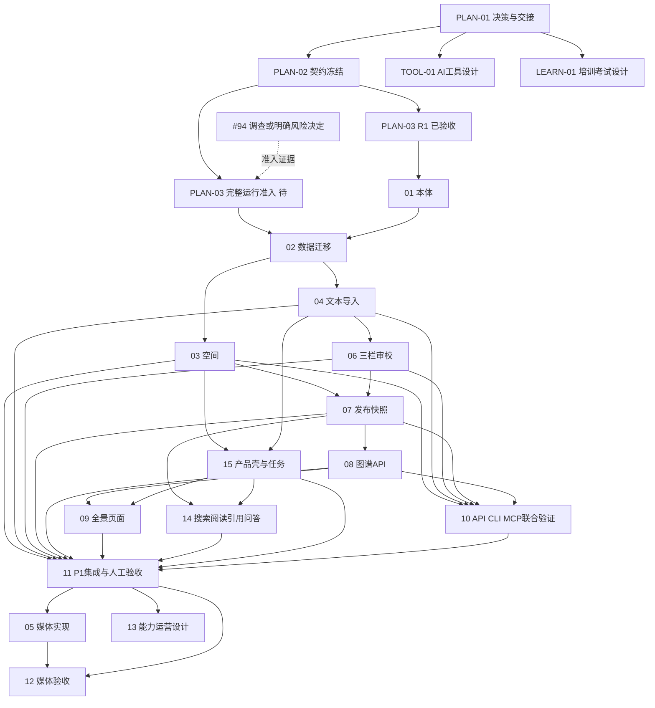

# v2 负责人任务路线图（2026-11-08 · r5（R1已批准））

2026-11-10最新：#105已验收、合并并更新知识库隔离测试，见[发布记录](release-2026-11-10.md)。#106/#107为Ready，消费[PLAN-03:R3](w0/r3-management-admission-2026-11-10.md)，先空间管理再导入串行领取；整体V2/FULL和后续发布仍独立。下方历史阶段快照不能覆盖本条。

**2026-11-09最新：#94已验收关闭，PR #132已合入integration（4fce492）；#105 / KBV2-02为Ready，明确消费PLAN-03:R2，只允许隔离合成数据开发，不等待#103父Issue关闭。整体FULL及其他任务/部署不自动解锁。见[R2交接](w0/r2-data-admission-2026-11-09.md)。**

**2026-11-08 发布更新：KBV2-01 已由负责人验收，PR #123 已合入 integration；官网测试/生产及知识库隔离测试发布成功。知识库 v2 页面与后续业务能力仍 planned，#94 / 完整运行准入保持独立。详见[验收与发布记录](release-2026-11-08.md)。**

**2026-11-08最新状态：PLAN-01/02设计已Accepted；#103仅R1通过，#104 Released（隔离测试）、执行者DeepSeek；完整运行准入未通过，#94继续调查。** 见[批准与准入记录](w0/r1-acceptance-2026-11-08.md)。

**当前：v0已验收、v2原型已评审通过；正在完善执行计划，KBV2-01离线模块已交付。** 共20项：3项设计准入、12项P1工程/验收、3项P2后续、2项其他产品设计。PLAN-01/02已Accepted、PLAN-03完整准入进行中、KBV2-01 Released（隔离测试），其余16项Planned；20项Issues已登记；实际人员和日历工期待分配。完整卡片见[next-work.md](next-work.md)，机器台账见[execution-plan.json](execution-plan.json)。

本轮已交付[W0设计与一次确认单](w0/README.md)，含14项决定、35项完整P1命令、KBV2-01本体schema与实现规范。**R1已批准并验收；#104 Released（隔离测试），父任务#103保持Open**。

## 已解除与剩余门槛

| 事项 | 当前事实 | 责任与下一步 |
| --- | --- | --- |
| v0人工验收 | 已确认，#85关闭 | 不再重复验收；按原交付限制复用 |
| 页面原型与交互 | 已通过，批准提交5a172f5 | ChatGPT维护后续变更；DeepSeek按该版本实现 |
| 设计PR | #121→#100→#99均已合并到integration | 真实merge SHA见R1验收记录 |
| 业务/架构决定 | D01—D14及ADR-011/012的P1方向已Accepted | 新缺口走设计变更，不自动扩张R1 |
| 完整API/CLI契约 | 35项设计已批准冻结 | 实现反馈走设计修订；业务验证随实现交付 |
| 撤权终态调查 | #94已验收关闭，#132已合并 | 56项CI与独立负例已核对；不外推所有竞态 |
| 实施准入 | R1已验收，仅#104 Released（隔离测试）；完整运行准入未完成 | 固定integration基线已回填；#94不默认接受 |

## 工作安排

| 顺序 | 工作包 | 主责 | 完成标准 |
| --- | --- | --- | --- |
| 已验收 | PLAN-01：现有实现与缺口、P1边界、审校/关系/图谱与配额决定 | ChatGPT设计；负责人确认决定 | 未决项有决定或明确P2后置；不重复确认已通过原型 |
| 已验收 | PLAN-02：schema/发布hash规范/兼容与页面动作矩阵 | ChatGPT；DeepSeek评估可实现性 | 每个命令输入/输出、CLI、错误和负例可检验 |
| 完整准入待处理 | PLAN-03：执行准入 | ChatGPT整理；负责人批准 | 设计集成SHA、#94处置、实现授权、具体成员与共享文件责任齐全 |
| W1 | KBV2-01/02：本体与数据迁移 | DeepSeek实现 | v0数据兼容、段落回填幂等、真实PG迁移恢复通过 |
| W2 | KBV2-03/04/06/15：空间、导入、审校、产品壳及任务 | DeepSeek实现 | 原型管理流程接真实API，片段可追溯，失败可恢复 |
| W3 | KBV2-07/08/09/14/10：发布、图谱、员工知识消费与多入口验证 | DeepSeek实现 | 同一发布快照驱动图谱/搜索/问答，权限审批无旁路 |
| W4 | KBV2-11：集成/迁移/恢复/产品验收 | DeepSeek验证；ChatGPT预审；负责人验收 | Linux证据、端到端、人工验收、试点范围及发布决定分别记录 |
| P2 | KBV2-05/12媒体，13能力运营设计 | DeepSeek实现05/12；ChatGPT设计13 | 另行批准供应商/数据/成本，媒体真实验证不冒充文本验收 |

## 依赖图

图中并行是逻辑依赖。涉及同一服务/前端插件/注册/锁文件时，由唯一修改人串行提交或先完成模块拆分设计，不能同时覆盖同一文件。所有实现任务同时交付CLI与schema，10只做联合验证收尾。

## PLAN-01已确认的决定

下列决定已由负责人批准，精确值以w0/decisions.md为准；容量目标不是实测通过证据：

| 决定 | 现有方向 / 建议 | 完成出口 |
| --- | --- | --- |
| P1/P2范围 | P1先文本闭环；排期/消费者管理/培训快照后置 | 负责人确认，统一README/契约/任务中的阶段标识 |
| 审校单位 | 片段逐条核验，条目修订整体审校与发布审批 | 明确接受/退回/合并/拆分及审批失效边界 |
| 关系与概念 | 首期相关/冲突/主题归属；supersedes仅修订层派生 | 关系清单、方向/证据/权限及变更审批规则固定 |
| 图谱与容量 | 现设计默认100/最多200分页、单次至多2000节点/5000边 | 拆清图查询与列表分页语义、规模/截断和实测预算 |
| 文件与任务限制 | 旧20,000字符限制不能默认为PDF/DOCX新限制 | 文件/批次/页数/展开体积/超时/并发额度、错误码与配置批准 |
| 发布与回退 | P1单条立即发布、原子快照CAS；回退创建新发布 | 失败不半发布，旧审批失效，回退仍重新验权/审批 |
| 共享身份差异 | 复用v0固定角色和共享目录，明确最小缺口 | 缺口有独立任务再解锁，不推定完整IAM已交付 |
| ADR与技术准入 | ADR的P1架构方向Accepted | 分别记录架构决定，不把页面评审当ADR批准 |

## 负责人如何看进度

以任务ID查看[next-work.md](next-work.md)。20项任务均已回填真实Issue编号与依赖链接，见[登记表](issue-registration.md)。本轮没有建立GitHub Project或启用额外强制规则，不声称已配置项目看板。后续每项Issue回填执行者、预审、基础SHA、PR、CI、人工验收和发布版本。原型Accepted只代表设计里程碑；任务工程完成、产品Accepted与Released分别统计，不按关闭数量混算完成率。

## 本次计划验证

已检查20项ID唯一、依赖无环、P1验收不依赖媒体、14/15纳入集成验收、JSON/Markdown任务一致、原型批准SHA/HTML摘要一致、相对链接与代码块，以及git diff空白。原型HTML和截图无改动；未重复运行浏览器、API、迁移、模型或官网视觉检查，因为本次仅更新任务文档，不包含运行时变更。
