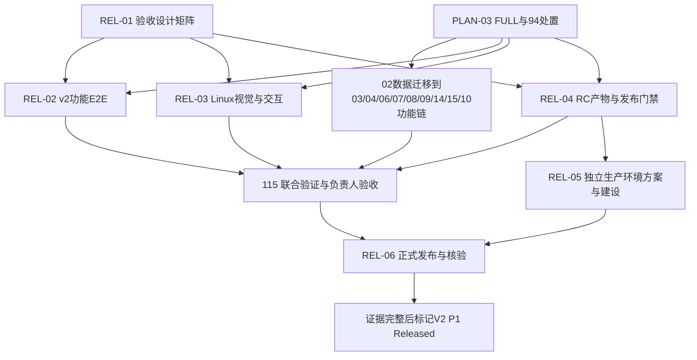

# 知识库 V2 P1：实现、验收与发布流程

2026-11-08 · ChatGPT / Codex 编制 · 本轮为规划与任务登记，不执行编码、环境初始化、迁移或发布。负责人已批准的原型继续有效；新增发布规则与生产环境方案进入设计评审，不伪造负责人批准。

## 1. 什么才算 V2 发布

V2 P1 是可实际使用的知识全景、空间管理、文本/PDF文本层/DOCX导入、片段审校、发布、搜索阅读引用问答与持久任务的完整闭环。仅完成本体模块、部署成功、HTTP 200 或保存截图，均不能宣称完整 V2 发布。媒体/OCR、排期与跨产品快照等 P2 工作不强行纳入 P1。

现状：#104 / KBV2-01 已验收并更新到知识库隔离测试；业务 Web 仍是 v0。#105—#115 的 P1 实现/联合验收尚未完成。#94 撤权终态调查无新结论，#103 只有 R1 通过，FULL 仍未通过。官网是独立产品；官网流水线不会发布知识库服务。

原型基线：`5a172f5582f308f2e4dfd5733d6ddfa221b77b68`，HTML SHA-256 `9366b34ff60b1f9b73f4028daeb2287cc183483b3699c6bd970b16b83476f720`。页面验收以[页面与交互规范](prototype-design.md)、[追踪矩阵](release-acceptance.md)及已批准 W0 契约为准；原型中的旧命令摘要不覆盖 W0 的完整版本化 schema。路由目标/部署前缀/旧 hash 兼容的实际映射由 #108 固定，未冻结项不能默认为已实现。

## 2. 顺序与出口

| 门槛 | 工作与主责 | 必须提供的证据 | 未通过时 |
| --- | --- | --- | --- |
| G0 范围与验收冻结 | ChatGPT完成页面/动作/状态/命令/用例矩阵；负责人确认新增规则 | 已批准原型、P1必选项、差异决定、每条AC的任务归属 | 不用旧v0用例作为v2完成证明 |
| G1 FULL实施准入 | #94 DeepSeek调查；#103 ChatGPT汇总、负责人决定 | 撤权/租约/终态证据或负责人明确风险决定、集成SHA、实际执行角色、文件所有权、实施授权 | R1不自动扩大，运行任务仍Planned |
| G2 逐项实现与集成 | DeepSeek实现；ChatGPT设计一致性预审；负责人分项验收 | #105—#114的代码、版本化schema/CLI、API/CLI同权负例、页面/状态证据 | 合入integration仅代表集成，不代表产品验收或发布 |
| G3 候选版本测试部署 | DeepSeek交付REL-02/03/04；按具体测试发布授权操作 | 固定RC SHA/产物digest、迁移清单、备份、已授权隔离测试、部署后前后端版本一致 | 称为集成预览/候选版本，不能标V2 Released |
| G4 联合验证与人工验收 | 复用#115；DeepSeek测试，ChatGPT对照原型预审，负责人体验确认 | 全部P1 AC通过、Linux证据、真实PG/恢复、真实模型受控验证、明确人工确认 | 失败修复并生成新RC；变更影响项重验 |
| G5 生产准备与发布批准 | REL-05环境建设；REL-06准备发布单；负责人批准具体环境和版本 | 独立知识库生产方案/环境、权限/凭据/监控、迁移恢复演练、测试同一产物、批准记录 | 允许止步测试验收，不冒称生产已发布 |
| G6 生产发布与核验 | 按批准的REL-06执行；ChatGPT核对证据 | 发布前备份、受控迁移、API/Worker/Web/CLI版本、认证业务冒烟、匿名拒绝、告警/回退结果 | 按触发条件停止/回退，记录实际状态 |
| G7 交付公告与交接 | ChatGPT回填，负责人接收 | 实际URL、scope/version/SHA/digest、AC结果、人工确认、部署run、限制/遗留项 | 结果不完整不得写“V2整体发布成功” |

实施、技术预审、人工验收、合并、测试部署、生产批准和发布核验分别记录。用户在会话中的明确确认可回填；代理和共享GitHub用户名不能冒充独立人工验收。先前KBV2-01的发布批准不自动覆盖未来V2生产迁移或新建环境。

## 3. 如何实现与协作

1. 保留#105—#114现有范围与依赖；#105从已验收#104继续，但仍要求PLAN-03:FULL。#106空间与#107导入可在数据库出口后按文件所有权安排，#109审校、#110发布、#111图谱API、#112全景与#113员工消费依序集成；#108承担壳/导航/持久任务。#114做API/CLI/受限MCP联合验证，不替各任务补写首次契约。
2. 每个PR写明Issue、原型页/AC、基础SHA、commandId/schema/CLI、允许目录、截图及用例证据。ChatGPT先核对设计，DeepSeek修订实现，负责人确认人工验收。官网源码/URL/SEO不在本轮调整范围。
3. 同一前端插件、平台注册、锁文件、迁移编号由一个明确修改人负责；可并行的是不冲突的模块。每项任务独立分支/工作目录，不覆盖他人改动。
4. 新规则由REL-01交付设计，REL-02/03/04由DeepSeek落实。实现中的设计缺口先交ChatGPT澄清，不能自行改原型或用mock成功填补。
5. 旧v0 E2E保留为兼容回归，新增命名独立的v2验收套件。v2门禁必须能拒绝旧首页，不能仅修改旧测试标题后称覆盖完成。

## 4. 候选版本与测试策略

- 分开运行模块测试、真实PG集成、契约/API/CLI同权、v2浏览器功能、Linux视觉和部署冒烟。输出AC ID、角色、场景、期望、实际、环境、SHA/digest、结果和证据URL；缺失/跳过的P1必选证据视为未通过。
- 浏览器合成夹具允许可控模型输出用于负例，但业务数据经真实API/服务持久化，不截获API来伪造功能成功；真实模型集成另列，不能拿合成测试替代。测试与生产仅使用专用最小权限验证账号、合成资料，凭据由受控Secret提供，日志脱敏，撤销/清理另验。
- Linux固定OS/Node/浏览器/字体、时区、视口、时间与合成种子，至少桌面1440×1000、移动390×844；动态requestId/时间可掩盖，图谱/空态/权限/操作控件不得整体屏蔽。
- 离线HTML与真实页面有渲染差异，不直接做逐像素等同。先由ChatGPT对照批准原型审查真实页面截图和交互，负责人确认首次真实Linux基线，再启用像素回归。保存截图不等于比较通过，自动更新基线不等于批准。
- 图谱使用确定性测试布局/种子且仍走真实可见资源API；规模/截断/实时撤权独立验证。不能靠固定假节点通过功能测试。
- REL-04构建不可变候选产物，包含API/Worker/Web/必要运行依赖、迁移和CLI版本关系；测试通过后提升同一digest到生产，不能从浮动分支重新构建替代。现有“复制旧release叠加六文件”只适用于KBV2-01，不能复用为完整V2发布方案。
- 发布清单应包含releaseScope、产品版本、sourceSha、artifactDigest、schema/migration/CLI版本、原型基线、requiredAC、每项证据及人工确认、部署环境/URL/run/实际版本、备份和恢复入口。未来只读版本输出由REL-04先冻结版本化commandId/schema/CLI设计再实现，不能临时塞入未授权的owner接口或泄露凭据。
- REL-04实现缺证据、错SHA/digest、未完成必选项、缺人工确认时拒绝发布的预检，并用负例证明。不能用--yes、dry-run或空审批绕过。GitHub保护/Environment审批需核实真实配置；没有配置之前只称待实现门禁，不能声称已强制执行。

## 5. 生产环境与恢复

目前只有知识库隔离测试入口 `https://www.nuochong.net/oa-test/product/`，没有已确认独立生产配置。REL-05先给出域名/路径和网关、服务/数据库/对象/备份/模型凭据/账号/日志的隔离方案、资源容量与成本、监控告警、TLS、安装与恢复步骤，交负责人确认后实施；不能把官网静态生产目录当成知识库生产，也不能直接共享测试数据库。

发布前在隔离恢复副本验证成对DB/对象备份可恢复。回退分别区分应用回退、迁移兼容和数据恢复；有新写入时禁止直接恢复旧库丢弃数据。失败触发条件包括迁移失败、API/Worker版本不一致、业务冒烟失败、权限泄漏、错误率/任务积压异常。负责人审批前需冻结具体阈值、观察窗口和执行人；先停止新写、保留证据，按已演练步骤处理。没有安全回退路径时不切换。

## 6. 任务、依赖与负责人查看方式

详见[补充任务卡与Issue](release-tasks.md)。本轮新增6项发布工作，不复制原有功能或#115联合验收；原20项加6项共26项。P1发布必需：原12项P1工程/验收 + 6项补充任务，PLAN-01/02/FULL是前置，P2和其他两产品设计不作为V2 P1阻塞。

“设计已输出”“代码已实现”“测试已通过”“负责人已验收”“测试已部署”“生产已发布”分别查看，不用Issue关闭数量推导整版完成。REL-05设计可提前整理，实际建设需批准；REL-02/03可按页面增量实现，完整验收仍依赖全部必选页面。下一步先评审REL-01矩阵与新发布规则，处理#94和FULL准入，再由DeepSeek领取依赖已满足的实现任务。本规划不声称已经解除运行准入。

## 本轮规划验证（不等于产品验证）

已验证26项任务/Issue唯一、依赖无环、#115包含REL-02/03/04且不被生产建设倒置阻塞、16条AC唯一、76个相对链接存在、代码块成对、批准原型HTML摘要未变化、新版本候选schema正反例。既有W0契约QA通过：35项planned契约、70项schema正例、110项负例、运行命令仍59项。本轮只有设计/任务文档，无应用/工作流变更，因此未运行产品构建、浏览器、迁移、模型或线上检查；这些属于后续任务，不能据本轮设计QA标记产品验收通过。
