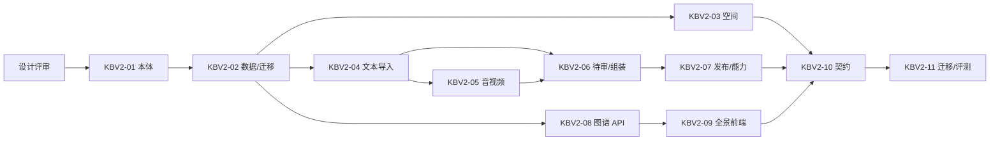

# 知识库 v2 任务拆分（planned）

2026-11-02 · 设计稿 v1 · 决策更新 2026-11-08 · **全部 planned，不开发、不排期、不创建 Issue**。本轮只交付设计；任何实现必须先完成设计评审、确认依赖、由负责人领取 Issue。任务 ID 为设计台账，不是 GitHub Issue 编号；估算为工程人日建议，不是日历承诺。

## 0. 设计评审（本轮）

| 项 | 内容 |
| --- | --- |
| 输入 | 本目录 6 份设计、[本体方法论](../../ontology/README.md)、[套件本体](../../ontology/suite-ontology.md)、[ADR-012](../../../adr/ADR-012-product-ontology-and-knowledge-graph.md)（Proposed） |
| 评审人 | 产品负责人、架构负责人、安全/运维（音视频与对象存储） |
| 通过条件 | 范围/不做的项确认；权限与审批无旁路；音视频供应链与数据边界有结论；v0 兼容与迁移可执行；命令/表/状态无矛盾 |
| 产出 | 评审记录、修订版设计、任务领取顺序；不产生实现代码 |

## 1. 任务表

| ID | 建议角色 | 范围 | 依赖 | 验收出口 | 估算 |
| --- | --- | --- | --- | --- | --- |
| KBV2-01 本体注册表与版本治理 | 平台/架构 | 类/关系/约束注册、manifest 片段、版本兼容、只读加载、审计；不建推理机 | 设计评审、ADR-012 接受 | 不兼容/重复 ID/未登记命名空间拒绝；版本升级/回退有迁移记录；三产品可声明片段 | 3–5 |
| KBV2-02 数据模型扩展与迁移 | 后端 | 空间 code/type、片段、概念、关系、导入批次/文件、能力表；v0 按段落回填与双读 | KBV2-01、KB-02/v0 已有模型 | 真 PostgreSQL 迁移/回滚；回填幂等；旧条目可读；跨空间关系按双方可见裁剪、证据引用拒绝 | 5–8 |
| KBV2-03 知识空间管理 | 后端/前端 | 列表、创建向导、设置、改名、归档、角色/部门范围、审计；从首页移除创建 | KBV2-02、IAM-03 | 编码唯一/部门停用/无权限/未豁免自批负例；改名后旧链接稳定；390px/键盘；CLI 同权 | 3–5 |
| KBV2-04 文本/PDF/DOCX 导入与片段任务 | 后端 | 批次/文件/校验/解析/片段/任务/重试/取消；locator 与 hash | KBV2-02、KB-04/v0 文本解析 | 三格式定位准确；空/加密/超限/伪装拒绝；强杀恢复不重复；配额 | 6–9 |
| KBV2-05 音视频/OCR 导入（P2） | AI/后端 | 外部大模型 ASR/OCR 适配、音视频抽取、时间码片段、置信度、失败码、数据边界 | KBV2-04、外部模型能力确认 | 文本类测试通过；外部适配器未配置明确失败；开关/审计/成本记录；不宣称 DeepSeek 可转写 | 6–10 |
| KBV2-06 片段待审与条目组装 | 后端/前端 | 待审区、片段接受/拒绝/合并/拆分、条目草稿、引用校验、冲突提示 | KBV2-04、KB-06/07 | 片段不能直接发布；引用漂移阻断；并发保留草稿；审校 hash | 4–6 |
| KBV2-07 发布与能力输出 | 后端/前端 | 发布批次/排期/撤回/回滚、manifest、能力目录、消费者、能力启停 | KBV2-06、KB-07/v0 已有发布 | 并发仅一成功；审批失效；能力失效即时；消费者不设白名单但仍需注册/凭据/审计；培训快照只读发布快照 | 5–8 |
| KBV2-08 图谱查询 API | 后端 | 可见集合、节点/边、跨空间关系、概念/关系、聚合/截断、graphVersion、缓存键 | KBV2-02、KBV2-06 | 权限裁剪无泄漏；跨空间仅双方可见；300/2k 节点性能；撤回后边消失；CLI 同权 | 3–5 |
| KBV2-09 知识全景前端 | 前端 | 力导向图、筛选、局部图、抽屉、列表兜底、移动端、无障碍 | KBV2-08、KB-11 | 交互/键盘/390px；空/错/截断状态；reduced motion；性能降级 | 5–8 |
| KBV2-10 契约、CLI 与 MCP | 平台/集成 | 完整 JSON Schema/OpenAPI、CLI 映射、MCP 白名单、负例、包安装 | KBV2-03/04/06/07/08 | API/CLI/MCP 同权；planned 不注册；审批/幂等不可绕过；独立安装 | 3–5 |
| KBV2-11 迁移、评测与试点 | QA/平台 | v0 迁移演练、按段落片段回填校验、检索/图谱质量、恢复、容量、合成数据 | KBV2-03—10 | 迁移/回滚演练；权限/撤回/强杀/并发；Linux 检查；不冒充生产容量 | 4–6 |

合计约 **47–75 工程人日**（仅用于比较范围，不是承诺）。不包含 ASR/OCR 外部服务采购、真实制度整理、法务/安全审批和等待评审时间。

## 2. 依赖与顺序

- P1 可先交付：01 → 02 → 03/04 → 06 → 07 → 08/09 → 10 → 11。
- 05（音视频/OCR）不阻塞 P1；外部大模型适配器未接入前只做接口与合成测试，不接真实外部服务。
- 02 的迁移与 11 的演练分开：先增量迁移，再回填，再演练回滚。

## 3. 任务卡要点（实现时必须补齐）

每个任务领取时按 [协作模板](../../../refactor/collaboration.md) 写 Issue，至少包含：

- **目标**：用户可验证的行为，不是“写了页面”。
- **范围/不做**：允许目录、相邻不做的项（如“不做跨空间证据引用”“不做通用 OCR 平台”）。
- **命令/schema/CLI**：新增或变更的 commandId、输入/输出、权限、副作用、幂等、审批；UI 变更若只是布局不强行造命令。
- **权限负例**：无权读/写、跨空间证据引用、跨空间关系撤权、管理员越权、未豁免自批。
- **失败与恢复**：解析失败、任务强杀、并发发布、引用漂移、撤回中查询、ASR 超时。
- **证据**：合成夹具、真实模型/外部 ASR 分开、Linux 检查、迁移/回滚记录。
- **未运行项**：明确原因，不用 mock 代替。

## 4. 与原 KB 任务的关系

| v2 任务 | 对应原任务（设计继承，不替代验收） |
| --- | --- |
| KBV2-01 | PLAT-01/02、KB-05（本体与插件契约） |
| KBV2-02 | KB-02（数据/迁移） |
| KBV2-03 | KB-03、KB-13（空间与维护 UI） |
| KBV2-04 | KB-04（上传/解析）、KB-06（编译前处理） |
| KBV2-05 | KB-04 后续（音视频/OCR，原设计列为后续） |
| KBV2-06 | KB-06/07（候选与审校）、KB-13 |
| KBV2-07 | KB-07、KB-14（发布/能力） |
| KBV2-08 | KB-08（检索/关系基础）新增图谱查询 |
| KBV2-09 | KB-11（首页/阅读 UI）重构 |
| KBV2-10 | KB-14（REST/CLI/MCP） |
| KBV2-11 | KB-17（质量/评测/恢复） |

原 KB-01—18 的完整验收不被本设计自动满足；v2 实现只覆盖其切片，未实现项继续 planned。

## 5. 已确认决策（2026-11-08）

1. ASR/OCR 由外部大模型适配器提供；测试阶段只用 DeepSeek 对文本类来源做识别/结构化，不测试音视频/扫描件。
2. 允许单人/演示空间通过 `allowSelfPublish` 显式开启自批发布；默认关闭并审计，关键制度空间建议分离。
3. 允许空间显示名改名；编码创建后不可变，旧链接按 code 稳定。
4. 允许跨空间条目关系；仅双方空间可见时返回；跨空间证据引用仍拒绝。
5. 能力消费者不设产品级白名单/数量上限；仍需注册、受限凭据、审计、可撤销，配额可配置。
6. v0 片段按段落回填；行号映射到段落片段。

仍未决：片段审校粒度、关系类型清单、双人复核、图谱节点上限/聚合、外部模型供应商/区域/保留期、跨空间证据引用何时开放、培训快照课程复核规则。未确认前不进入实现；设计评审只确认方向与边界，不把估算当承诺。
