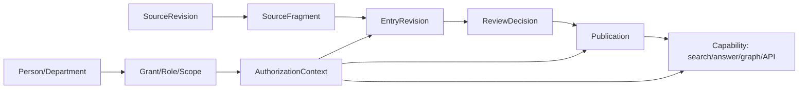

# 产品本体方法论：统一语义层、证据链与知识图谱

2026-11-02 · 设计稿 v1 · **planned，待产品与架构评审**。本文定义诺崇三产品共用的本体方法，不包含实现，不注册命令，不改变任何已验收范围。详细类与关系见 [产品套件本体](suite-ontology.md)，知识库落地见 [知识库 v2 设计](../knowledge/v2/README.md)，架构决策见 [ADR-012](../../adr/ADR-012-product-ontology-and-knowledge-graph.md)（Proposed）。

## 1. 为什么要本体

公司三产品（企业知识库、企业 AI 工具、培训和考试）共用 Harness 基座、组织与授权插件、任务与审批。若每个产品各自定义“知识页、来源、课程、题目、工具、成绩”等概念，会出现四类问题：

1. 同一个“制度依据”在知识库叫 page、在培训叫资料、在工具叫附件，无法互相引用和失效传播。
2. 权限按产品表复制，跨产品组合时出现两套人员和角色真相。
3. 模型生成的“关系”没有类型和证据，无法审核，也无法在撤回时精确失效。
4. 对外 API/CLI/MCP 各说各话，外部系统无法稳定发现“这是什么、依据是什么、谁能看”。

本体在这里不是哲学讨论，而是**可版本化的概念、属性、关系与约束**，用于统一命名、稳定身份、证据链、权限和契约。它服务于产品与工程，不追求形式化推理的完备性。

## 2. 元模型

所有产品共享同一套元模型。类、属性、关系、约束和实例都必须有稳定 ID。

| 元概念 | 作用 | 关键字段（设计） |
| --- | --- | --- |
| `OntologyNamespace` | 命名空间隔离 | namespace、owner、productId、status |
| `OntologyVersion` | 本体版本 | semanticVersion、changeType、compatibleWith、publishedAt、migrationRef |
| `OntologyClass` | 类型 | id、prefLabel、altLabels、definition、parent、abstract、status、constraints、uiHint |
| `OntologyProperty` | 属性 | id、domain、datatype、cardinality、required、sensitivity、validation、sourceOfTruth |
| `OntologyRelationType` | 关系类型 | id、from、to、direction、cardinality、semantics、inverse、evidenceRequired、permissionPropagation |
| `OntologyConstraint` | 约束 | id、appliesTo、rule、severity、errorCode、testRef |
| `OntologyInstance` | 实例 | id、type、properties、relations、provenance、revision、status、aclRef |
| `OntologyBinding` | 与存储/契约绑定 | classId、table/API field、readOnly、migration |

约束不是文档口号，必须能落到可执行测试。例如“已发布条目至少一个有效证据片段”对应发布命令的负例；“部门树无环”对应组织命令的数据库约束与测试。

## 3. 分层

```text
nc:                 上层本体（跨产品最小共识）
  ├─ nc.org:        组织与人员（共享插件）
  ├─ nc.access:     角色、授权、审批（可信核心）
  ├─ nc.kb:         企业知识库（产品插件）
  ├─ nc.tool:       企业 AI 工具（产品插件，planned）
  └─ nc.learn:      培训和考试（产品插件，planned）
```

| 层 | 内容 | 变更权限 |
| --- | --- | --- |
| 上层 | 组织、人员、角色、资源、证据、活动、产物、能力、事件、审批 | 架构负责人 + 产品负责人 |
| 共享 | 部门树、成员关系、授权绑定、任务、对象存储、审计 | 架构负责人；涉及安全需 ADR |
| 产品 | 知识空间、来源、片段、条目、关系、发布；工具、课程、题目、成绩 | 产品负责人 + 架构负责人 |
| 租户扩展 | 企业自定义分类、标签、显示字段、非安全语义的扩展关系 | 后续版本；命名空间隔离，不改安全语义 |

首期只启用上层、共享与知识库三层；AI 工具和培训只登记类与关系草案，具体设计后续独立评审。租户扩展不在首期实现。

## 4. 设计规则

这些规则对三产品同时生效，代码评审与产品评审都以它们为检查项。

1. **单一身份**：人员、部门、主体、角色只来自 `identity-company` / `organization` / `access-management`；产品引用稳定 ID，不复制主库，不用邮箱或名称做关联键。
2. **类型、实例、视图分离**：`KnowledgeEntry` 是类型，某条制度是实例，“知识首页卡片”只是视图，不能成为本体类。
3. **关系必须具名**：每条边有类型、方向、基数与语义；不允许只有“相关”而没有原因、权重或证据。`related_to` 也必须带 reason。
4. **证据链**：对外发布的结论必须能沿 `EntryRevision → Fragment → SourceRevision → 原始对象` 回溯；模型摘要不能成为唯一依据。
5. **不可变与版本**：来源修订、已发布修订、发布快照不可变；草稿可改；撤回不改历史，只改当前指针与有效性。
6. **时间语义**：区分 `recordedAt`（系统记录）、`validFrom/validUntil`（业务有效期）、`asOf`（查询视角）；不得用上传时间冒充生效时间。
7. **权限在实例**：授权按资源实例与范围判定；图谱、搜索、导出、事件都不能先返回再过滤。关系不自动传播权限，只有显式声明的传播规则才生效。
8. **模型产出是候选**：模型可以建议片段、分类、关系、摘要和冲突，但进入“已审核/已发布”必须由人确认；模型不能改变权限、审批或发布指针。
9. **变更版本化**：本体变更走提案、评审、版本号与迁移；只增不改语义，破坏性变更升 major 并保留旧版本一个迁移窗口；不物理删除类或关系。
10. **三入口同构**：Web、CLI、MCP 与外部 API 使用同一 commandId、schema、资源 ID 和授权规则；UI 不是第二套真相。
11. **安全语义不可扩展**：租户或插件不能新增“绕过授权”“自动发布”“伪造证据”的类型或关系；安全相关变更必须 ADR。
12. **最小充分**：能用一个类表达就不用两个；不为未来可能的分析需求预建图数据库、向量库或推理机。

## 5. 本体、权限与证据如何配合



- 鉴权发生在读取实例与执行命令时；图谱查询先计算可见集合，再生成节点/边。
- 证据边是发布校验与撤回失效的依据；来源撤回或 ACL 收紧时，依赖条目与能力实时失效。
- 审批绑定目标内容 hash 与范围；本体版本、发布版本、授权 epoch 都进入缓存键。

## 6. 运行时与存储（设计，不是实现）

| 组件 | 职责 | 首期形态 |
| --- | --- | --- |
| 本体注册表 | 加载各产品 manifest 的 ontology 片段，校验命名空间、版本、依赖 | PostgreSQL 表 + JSON manifest；只读加载 |
| 校验器 | 类型、基数、必填、枚举、时间、引用完整性 | 应用层 + 数据库约束；错误码稳定 |
| 图谱投影 | 从权威表生成节点/边，按权限过滤 | 读模型/查询服务；不引入图数据库 |
| 契约生成 | 由类/属性生成 API/CLI schema 草稿 | 设计阶段手工评审，后续生成需 ADR |
| 导出 | JSON-LD/SKOS 兼容导出 | 后续版本；首期不承诺 RDF 推理 |

不引入 OWL 推理机。原因：三产品当前需要的是稳定语义、证据和权限，而不是自动分类推理；推理结果难以审计，且会与人工审校冲突。若未来需要，先做独立评估与 ADR。

## 7. 治理与变更流程

1. **提案**：新增/修改类、属性、关系必须写清用途、影响产品、兼容性、权限影响、迁移与回滚、测试。
2. **评审**：架构负责人 + 相关产品负责人；涉及身份、授权、发布、证据链的变更增加安全评审；破坏性变更需 ADR。
3. **版本**：`major.minor.patch`。新增可选属性/类为 minor；语义变化、删除、基数收紧为 major；仅文案/示例为 patch。
4. **迁移**：major 变更提供双读/回填/切换/回滚方案；旧版本至少保留一个发布周期；迁移脚本与数据校验分开记录。
5. **弃用**：标记 `deprecated`，保留读取与导出；不物理删除；UI 显示迁移提示。
6. **审计**：本体变更记录提案人、评审人、版本、迁移结果；运行时只读，变更只能通过受控迁移。

## 8. 三产品应用

| 产品 | 共享本体 | 产品扩展（首期设计范围） | 状态 |
| --- | --- | --- | --- |
| 企业知识库 | 组织、人员、角色、证据、活动、产物、能力 | 知识空间、来源、片段、条目、概念、关系、审校、发布、能力输出 | 本次详细设计 |
| 企业 AI 工具 | 同上 + 工具/版本/运行/产物/审批 | 工具卡、输入 schema、授权执行、外部副作用、产物 | 仅登记类与关系草案 |
| 培训和考试 | 同上 + 课程/题目/考试/成绩/能力 | 课程、课时、题库、试卷、作答、评分、能力项 | 仅登记类与关系草案 |

三产品共用“证据、审批、发布、能力”语义，但业务规则独立：知识发布不等于课程发布，课程成绩不能反向改写制度；工具运行产物可以引用知识快照，但不能把知识页当执行授权。

## 9. 反模式

- 用自由文本标签代替类型与关系，导致无法校验和失效传播。
- 为每个产品建一套“知识页/资料/附件”，再做同步。
- 把模型生成的“相关”边直接展示给员工，没有证据和审核。
- 图谱先取全量再前端过滤权限。
- 本体一次建模到终极形态，导致首期无法交付。
- 用图数据库/向量库替代权威状态与证据链。

## 10. 设计验收

本方法论的验收不是“文档写完”，而是下一轮实现任务能逐条落地：

- 每个类和关系有唯一 ID、定义、基数、约束和归属产品；无孤立术语。
- 关键约束有对应负例：无证据发布、跨空间引用、自审批、撤权后图谱泄漏、重复空间编码、部门环。
- 同一资源在 Web/CLI/API/MCP 的 ID、状态和错误码一致。
- 本体版本与产品 API 版本独立，manifest 能拒绝不兼容组合。
- 租户扩展不能改变授权、审批、发布和证据语义。

## 11. 关联文档

- [产品套件本体：类、关系与现有模型映射](suite-ontology.md)
- [知识库 v2 功能设计](../knowledge/v2/README.md)
- [共享组织与权限设计](../shared-access/design.md)
- [产品体系与三条技术路线](../portfolio.md)
- [ADR-011 三产品插件体系](../../adr/ADR-011-product-plugins-llm-wiki.md)（Proposed）
- [ADR-012 产品本体与知识图谱](../../adr/ADR-012-product-ontology-and-knowledge-graph.md)（Proposed）
- [CLI 优先规范](../../refactor/cli-native.md)
