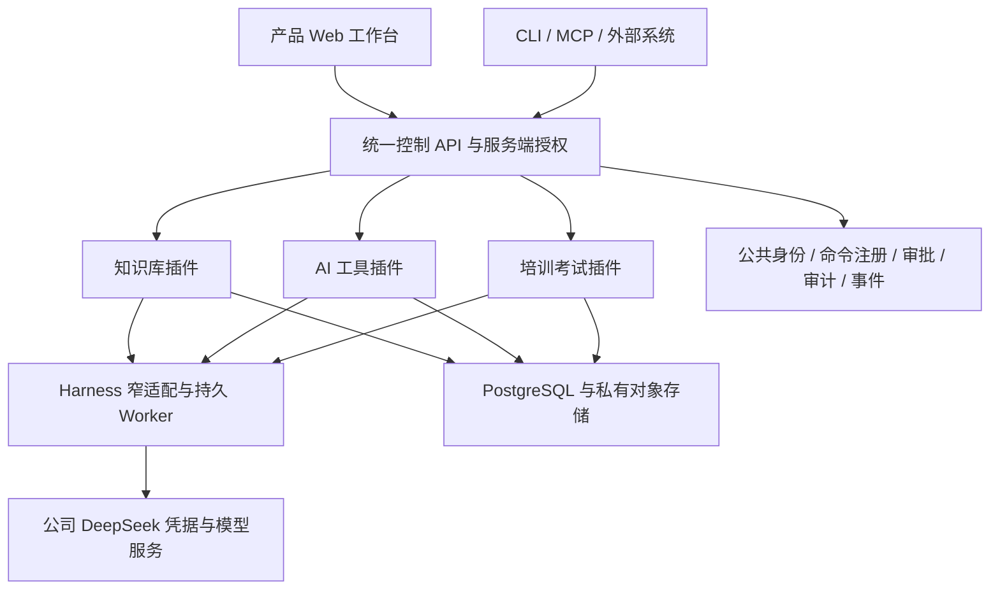

# 公司产品体系：一个 AI 基座、三个产品插件

2026-11-01 · 设计 v1 · planned，非既有实现清单。

## 定位与产品边界

诺崇以 DeepSeek Harness 为统一 AI 执行基座，向企业提供知识、工具与学习三个独立可启用、组合使用的产品。统一入口、公司身份、模型供给、任务状态、审计及 API/CLI/MCP 协议共享；每条产品线拥有自己的领域规则、页面、数据和版本。官网继续独立，产品入口以后演进为公司工作台。

| 产品 | 主要使用者与价值 | 首个闭环 | 后续路线 | 本轮边界 |
| --- | --- | --- | --- | --- |
| 企业知识库 | 全员查制度，内容负责人维护可信知识，其他系统引用制度依据 | 来源导入→编译知识页→审校发布→浏览/搜索/引用问答→质量维护 | 外部同步、更多知识域、跨系统知识服务 | 本轮详细设计并拆任务；实现 planned |
| 企业 AI 工具 | 员工使用受控 AI 能力处理具体工作 | 管理员发布工具卡→员工提交结构化输入→授权执行→查看和下载结果 | 模板组合、业务系统动作插件、审批工作流 | 先规划，不开发通用自动化平台或任意 shell |
| 培训和考试 | 员工学习、讲师组织课程、考试管理员验证效果 | 从已发布知识建立课程与题库→人工审核→分配学习/考试→确定性评分→成绩审计 | 学习路径、补考、证书、外部 LMS 对接 | 先规划，不恢复旧培训演示或 AI 自动裁决正式成绩 |

## 技术基座的职责

- 官方 Harness 负责模型调用、Agent/工具执行和事件，通过公开 Profile/窄适配层接入；不修改上游核心。
- 控制 API 与 PostgreSQL 负责调用方身份、资源权限、任务/运行权威状态、幂等、审批、审计和产品数据。模型无权决定用户身份或发布内容。
- 对象存储负责原始文件、生成产物和不可变 Wiki 版本的字节；PostgreSQL 保存 manifest、hash、引用、状态及发布指针。文件系统是受控工作副本，不承担业务权威。
- 第一阶段采用模块化单体 API + 独立持久 Worker，按信任域隔离执行；保持可拆部署边界，不先引入微服务和独立向量集群。
- 公司模型凭据仅保存在服务端，默认供应 DeepSeek。访客不登录 DeepSeek、不填写个人 Key；缺失/失效时由服务端返回“演示服务暂不可用”，不转为自带 Key 引导。



## 插件究竟是什么

业务规则放在产品插件，Harness 适配插件只声明受限工具并调用领域服务。平台基础设施保留为可信核心，不能为了“全部插件化”把授权、审批或任务状态机交给任意插件。

每个批准的插件包声明：`id`、SemVer、兼容的 platform API major、配置 schema、依赖、领域命令、Web 路由、事件订阅、所需权限、迁移版本、启停/健康/卸载策略。命令均有独立 `commandId@v1`、输入输出 schema 和 CLI 映射。第三方插件将来使用隔离进程/容器和受限服务凭据，不能把陌生 npm 包直接加载进 API 进程。

插件之间只走公开领域接口或版本化事件，不能读取其他插件的表。编译任务使用不可变来源快照；课程/工具引用已发布的知识快照。知识撤回事件触发关联工具材料、课程和题目“需要复核”，不能无声篡改已完成考试的历史依据。

### 生命周期

`registered → validated → enabled → draining → disabled`。禁用后不再接受新写命令；已有任务按声明完成或显式取消，读历史和审计保留。迁移受平台审批执行；删除代码不自动删除数据。升级先兼容检查、备份和合成契约回归，再分环境推广；回退不得跨越不兼容 schema，采用 expand/contract。

### 建议目录（尚未创建业务实现）

```text
apps/product-web/                 # 员工工作台，与 apps/oa 原生管理员页面分离
apps/control-api/                 # 复用现有控制 API
packages/platform/               # 身份、能力注册、审批、事件与插件生命周期
plugins/knowledge/               # domain / application / api / worker / harness / web / contracts
plugins/enterprise-tools/        # 工具目录、执行与产物
plugins/learning/                # 课程、题库、考试与成绩
plugins/connectors/              # 标准导入适配；厂商适配各自独立
contracts/product/              # 能力元数据、JSON Schema、OpenAPI、事件 schema
```

## 三条产品的交付顺序

| 波次 | 知识库 | 企业 AI 工具 | 培训和考试 | 共同依赖与出口 |
| --- | --- | --- | --- | --- |
| P0 | 设计与产品评审 | 工具卡/权限技术设计 | 知识引用/考试领域设计 | 本轮成果；下轮确认规则，不同时开三个 MVP |
| P1 | 来源、编译、审校发布和浏览 | 只保留平台扩展契约 | 只保留引用契约 | 插件骨架、员工身份、公司模型、统一命令 |
| P2 | 引用问答、维护、API/CLI/MCP 试点 | 选择首个真实办公痛点，再做工具目录/输入 schema/受控运行/产物下载 | 做课程/题库设计验证，不发布正式成绩 | 知识库通过试点验收后，产品线可并行 |
| P3 | 首个厂商连接器、知识域扩展 | 工具审批、失败补偿、业务连接器 | 课程发布、学习分配、考试规则、评分与申诉审计 | 各产品独立验收，不用知识库的 Go 代替 |
| P4 | 持续质量及容量优化 | 工具组合和运营 | 学习路径/补考及外部 LMS | 数据规模、效果和业务需求驱动 |

AI 工具使用 ToolDefinition（版本、输入输出、运行范围、审批和产物策略）与 ToolRun。每个高风险动作显式审批；失败不重放未知远端写结果。课程采用 CourseVersion / Lesson / QuestionVersion / ExamDefinition / Attempt / Grade；考试服务端计时、分配题目和提交幂等，客观题确定性评分，主观题 AI 仅给评阅建议，人工确认正式分数。两条产品线详细排期在其独立需求评审后形成，不给虚假的工期承诺。

## 演示环境与员工产品入口

现有原生管理员站点可继续作为封闭产品演示；配置公司模型、取消自动模型登录/Key 引导。它仍有 owner 能力，不能因此开放成全员工作台。产品壳是独立 Web 插件入口，先交付知识库，再逐步挂载工具和培训。全员入口使用受限公司身份，各用户任务与会话隔离。
