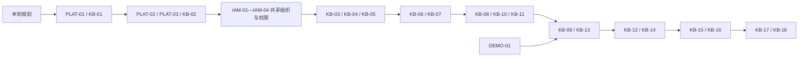

# 产品体系与知识库任务计划

2026-11-08后续工作细化见 [20项执行任务卡](knowledge/v2/next-work.md) 与 [JSON台账](knowledge/v2/execution-plan.json)。保留原KB/IAM完整范围及历史状态，先核实v0缺口，不重复建设；设计批准、实现、人工验收和发布分别记录。

2026-11-01 · 完整规划 v1 + 初版工程 v0。用户已进一步授权建设知识库初版：已拆分并领取 KBV0-01—07（Issues #71—77），完成共享平台/身份/组织与知识闭环的初版工程切片，部署隔离测试。详见 [初版实际台账](v0/tasks.json)与 [范围/待办](v0/README.md)。下表保留完整任务验收范围，未交付部分继续 planned，不将切片当作完整原任务 Accepted；v0已交付范围人工验收已于2026-11-08由负责人确认，见[验收记录](v0/acceptance-2026-11-08.md)；下一轮澄清继续保留，原完整任务不自动Accepted。历史 OA-01—OA-06 已验收，不重新计算为待办。

2026-11-02：负责人要求先设计知识库 v2（知识全景图谱、空间/导入/发布重构、本体方法），**不开发**。设计见 [知识库 v2 设计](knowledge/v2/README.md)，当时的实现任务为KBV2-01—11；现已更新为[20项执行计划](knowledge/v2/tasks.md)，原型已确认，代码尚未启动、实施Issue未创建，具体排期在准入后登记；不覆盖下表原 KB 任务的验收状态。

## 调度、分工和验收方式

状态流：Planned → Ready（依赖 Accepted，负责人确认范围）→ In progress → In review → Implemented（测试证据齐全）→ Accepted（负责人明确验收）→ Released（独立发布记录）。设计已形成不是人工验收通过。每任务独立 codex 分支，关联后续 Issue/PR；集成到 refactor/integration，test/main 是发布环境。

任务卡必含 owner、范围/不做项、依赖、版本化命令/schema/CLI、测试证据、人工验收和部署记录。Web/CLI/MCP 共用业务服务，拒绝无副作用；合成夹具与真实模型证据分开。任务人日为下一轮估算建议，不含等待授权、制度整理和团队评审，不是日历承诺。

## 平台与演示前置

| ID / 建议负责人 | 范围与交付 | 依赖 | 验收标准 | 估算 |
| --- | --- | --- | --- | --- |
| DEMO-01 平台（已实施，未人工验收；[交付记录](demo-delivery.md)） | 公司模型服务端配置、原生演示不弹 DeepSeek 登录/Key 输入；空浏览器冒烟和运维说明。仅封闭管理员演示，不交付员工身份 | 已验收 OA 基座 | 新 Cookie/重启后无模型引导；公司模型真实对话成功；缺失/失效不跳 BYOK；凭据不入浏览器/仓库/日志；原登录/WS 正常 | 1–2 |
| PLAT-01 架构 | 评审 ADR-011、三产品边界、插件 manifest/schema 和依赖；形成实际运行技术原型 | 本轮整体规划 | 安装/启用/排空/禁用正反例；不兼容 major 拒绝；平台授权不可被插件覆盖；明确第一方边界 | 2–3 |
| PLAT-02 后端 | 插件注册、命令/路由/事件隔离、迁移登记与合成示范插件；不建插件市场 | PLAT-01 | 同名命令冲突拒绝；禁用不接新写；历史可读；受限凭据不能查其他插件表；升级/回退记录完整 | 3–5 |
| PLAT-03 身份/前端 | 员工产品壳与现有受限身份衔接，三产品入口，管理员原生站点独立；公司模型代理 | PLAT-01 | 空登录流程无 Key/DeepSeek 登录；员工无 owner 接口；会话隔离/撤权/401/403；未实现产品标 planned | 3–5 |

## 共享组织、人员和权限插件任务

公共数据与管理由 IAM 任务负责，KB-03 仅实现知识资源 ACL/发布约束，避免重复交付。以下均 planned。

| ID / 建议负责人 | 范围与交付 | 依赖 | 验收标准 | 估算 |
| --- | --- | --- | --- | --- |
| IAM-01 架构/产品 | 冻结共享身份/组织/授权插件边界、模型、14 项候选命令完整 schema/CLI、组合与禁用规则 | PLAT-01 | 三产品 ID/权限命名空间一致；身份/组织/角色/资源 ACL 分离；依赖组合正负例和调岗/停用规则可执行 | 2–3 |
| IAM-02 后端 | 统一部门树、最小人员目录、多部门关系、身份映射和版本化变更事件；不做 HR 档案或具体厂商连接器 | IAM-01、PLAT-02 | 真数据库无环/并发/幂等、稳定 ID、停用不删历史、目录重放/乱序负例；受限身份不能传入角色提权 | 3–5 |
| IAM-03 后端/安全 | 产品权限注册、角色模板/范围绑定、委托边界与审批、可信授权执行及 epoch 撤权 | IAM-02、PLAT-03 | 三产品跨权限负例、不能自授权、旧角色版本不能扩大范围；调岗/停用立即影响 API/CLI/MCP/下载/排队任务；缺依赖失败关闭 | 4–7 |
| IAM-04 前端/QA | 官网主题的统一组织/人员/角色管理页与共享选择器、产品筛选、跨产品集成验证；目录厂商接入留后续 | IAM-03 | 三产品跳同一管理入口；role 绑定显示产品与资源范围；变更影响预览/审批；禁用/卸载不删历史；390px/键盘与同权负例通过 | 3–5 |

## 知识库分阶段任务

| ID / 建议负责人 | 范围与交付（不超出本项） | 依赖 | 可验证验收标准 | 估算 |
| --- | --- | --- | --- | --- |
| KB-01 产品/架构 | 冻结首期制度范围、角色矩阵、默认规则、容量目标、页面与命令清单；不实现业务 | 本轮规划 | 每个待决策项有决定/负责人/适用环境；26 项候选命令去留可追踪；评审记录不冒充实现 | 1–2 |
| KB-02 后端 | 空间、来源/修订、Wiki/修订、依赖、变更集、发布 manifest 数据迁移；对象 hash 存储 | KB-01、PLAT-02 | 真 PostgreSQL+私有对象存储迁移/恢复；修订不可变；重复 stableId/version/hash 处理明确；已发布原子指针 | 3–5 |
| KB-03 后端/身份 | 复用共享人员/角色，专注知识资源 ACL、审批 hash、来源交集与统一读路径策略 | KB-02、IAM-03 | A/B 来源权限交集；标题/计数无泄漏；撤权与下载并发负例；跨用户问答不可读；Web/API/CLI 同权 | 3–5 |
| KB-04 后端/文档 | 上传、隔离、大小/类型/hash 校验与文本 PDF/DOCX/MD/TXT 解析定位；不做 OCR | KB-02、KB-03 | 合成四格式可定位；扫描件/压缩炸弹/伪扩展/超限拒绝；失败不产空成功；原文不可被模型改写 | 3–5 |
| KB-05 架构/AI | Wiki schema、可信规则、引用/链接格式、受限 Harness 工具与任务级工作区 | KB-01、PLAT-02 | 规则/来源分离；恶意文档指令不能写 raw/越权工具；生成页 schema 有效；工作区清理不删权威资料 | 2–3 |
| KB-06 AI/后端 | ingest 增量编译 Worker、依赖影响、可审校 diff；不自动发布 | KB-04、KB-05 | 同幂等键同任务/异输入冲突；CAS/fencing；强杀重试不重复写；真模型生成候选及引用；失败不改现行版 | 4–6 |
| KB-07 后端 | 审核/退回、发布/排期/撤回/回滚，来源失效及缓存失效 | KB-03、KB-06 | 修改后审批失效；同时发布仅一份成功；未来/过期不当现行；撤回即时阻断；回滚不恢复无效来源 | 3–5 |
| KB-08 搜索 | 权限检索、中文分词/同义词、目录和链接扩展、可重建索引；暂不强依赖向量库 | KB-03、KB-07 | 标注集 Recall@5 达目标；无权标题/片段零泄漏；重建不恢复撤回内容；给出真实中文检索评测 | 3–5 |
| KB-09 AI | query 有引用问答、私有答案、依据复查/错误/取消、可选沉淀候选 | KB-08、DEMO-01 | 50 正例/20 无依据或冲突集；引用全可定位；撤回中生成返回 EVIDENCE_CHANGED；费用 unknown 不记0；不自动发布问答 | 4–6 |
| KB-10 质量/AI | lint 确定性规则和模型冲突建议、影响分析、反馈和处理审计 | KB-06、KB-07 | 缺来源/死链/过期阻断；语义冲突有证据和人工决定；修复仅候选；重复 lint 可比对、不重复发布 | 2–4 |
| KB-11 前端 | 员工首页、搜索、阅读、原文与引用抽屉；不做维护操作 | KB-07、KB-08、PLAT-03、IAM-04 | 接真实 API；按页面设计复用官网品牌色、Logo、字体栈、按钮/卡片主题；390px/键盘可用；空/无权/撤回/错误状态；来源版本常驻；官网无回归 | 3–5 |
| KB-12 前端 | 问答页面、任务跟随/明确取消、反馈与引用跳转 | KB-09、KB-11 | 不把断流当成功；私有历史隔离；证据失效清楚；不出现 Key 输入；schema 失败无假答案 | 2–4 |
| KB-13 前端 | 来源/导入/审校 diff/发布/质量管理 UI | KB-07、KB-10、KB-11 | 三栏核验完整；权限与审批服务端判定；重复提交幂等；版本冲突保留草稿；失败可恢复 | 3–5 |
| KB-14 平台/集成 | REST/OpenAPI、完整 JSON Schema、26 项中获批准命令的 CLI 与受限 MCP；不是只写文档 | KB-07、KB-09、KB-10 | 所有已实现命令能力发现准确；API/CLI/MCP 同权及负例；独立包安装；planned 不注册为成功；所有写审批/幂等不可绕过 | 3–5 |
| KB-15 集成/后端 | 标准推送导入、外部版本映射、签名 Webhook、Inbox/Outbox/死信重放 | KB-07、KB-14 | 重复/乱序/断连/签名重放测试；上游删除与 ACL 收紧失效；未知写结果待核对；无全文事件泄漏 | 3–5 |
| KB-16 前端/平台 | 集成中心、任务/审计、受控导出和恢复手册 | KB-13、KB-15 | 游标/死信可查；导出下载再验权；Markdown+manifest 备份可独立校验；不回显凭据 | 2–4 |
| KB-17 QA/平台 | 全链路/安全/恢复/容量评测和合成演示脚本；不代替真实生产容量 | KB-12、KB-13、KB-14、KB-16、IAM-04 | 质量与性能目标实测；撤权/任务强杀/发布竞争/注入全通过；同产物恢复有证据；Linux 检查与 macOS 原型分开 | 3–5 |
| KB-18 负责人/运营 | 试点范围、真实制度导入审批、用户培训、Go/No-Go 和分环境发布 | KB-17 | 负责人明确产品验收；数据授权/归口清楚；回滚和监测可用；生产发布另留记录 | 1–2 |

## 知识库 v2 设计切片（planned，2026-11-02）

负责人要求先设计不开发：知识首页关系图谱；来源管理拆为知识空间/知识导入/知识发布；导入文本/视频/语音并生成可追溯片段；发布输出知识能力；本体方法贯穿三产品。完整设计见 [知识库 v2](knowledge/v2/README.md)，任务卡见 [KBV2 任务表](knowledge/v2/tasks.md)。

| ID | 范围 | 依赖 | 验收出口 | 估算 |
| --- | --- | --- | --- | --- |
| KBV2-01 | 本体注册表、manifest 片段、版本兼容与治理 | ADR-012 接受 | 命名空间/版本/重复 ID 负例；三产品可声明 | 3–5 |
| KBV2-02 | 空间/片段/概念/关系/导入/能力表与 v0 迁移 | KBV2-01、KB-02 | 真库迁移/回滚；回填幂等；旧数据可读 | 5–8 |
| KBV2-03 | 知识空间管理（列表/创建/设置/归档） | KBV2-02、IAM-03 | 编码唯一、部门/权限/自批负例 | 3–5 |
| KBV2-04 | 文本/PDF/DOCX 导入与片段任务 | KBV2-02、KB-04 | 定位准确；空/加密/超限拒绝；强杀恢复 | 6–9 |
| KBV2-05 | 音视频/OCR 导入（外部大模型适配） | KBV2-04、外部模型确认 | 文本类测试通过；外部未配置明确失败；数据边界/审计 | 6–10 |
| KBV2-06 | 片段待审与条目组装 | KBV2-04、KB-06/07 | 片段不可直发；引用漂移阻断；并发保留草稿 | 4–6 |
| KBV2-07 | 发布、排期、撤回、能力输出 | KBV2-06、KB-07 | 并发仅一成功；审批失效；能力同步失效 | 5–8 |
| KBV2-08 | 图谱查询 API 与权限裁剪 | KBV2-02、KBV2-06、KBV2-07 | 无泄漏；性能/截断；CLI 同权 | 3–5 |
| KBV2-09 | 知识全景前端 | KBV2-08、KB-11 | 键盘/390px/空错态/降级 | 5–8 |
| KBV2-10 | 契约、CLI、MCP 与包安装 | KBV2-03/04/06/07/08 | 同权负例；planned 不注册；审批不可绕过 | 3–5 |
| KBV2-11 | P1迁移演练、评测与试点 | KBV2-03、04、06、07、08、09、10（不含05） | 迁移/回滚；权限/撤回/强杀；Linux 检查 | 4–6 |

合计约 47–75 工程人日，仅用于范围比较，不构成排期或交付承诺。原 KB-01—18 的未交付项继续 planned，v2 切片不自动满足其验收。

## 后续产品任务占位（不作为本轮知识库前置）

| ID | 范围 | 依赖 | 验收出口 |
| --- | --- | --- | --- |
| TOOL-01 | 选择首个企业 AI 工具场景、输入/输出、权限与副作用，形成产品设计 | PLAT-01；建议 KB-18 后 | 真实痛点/使用者/成功指标确认，不以通用聊天代替工具 |
| TOOL-02 | 工具目录、版本化模板、受控执行/审批、产物下载的 MVP 任务拆解 | TOOL-01、PLAT-02/03 | 命令/schema、补偿/幂等、审计与页面验收标准齐全 |
| LEARN-01 | 培训/考试流程、课程/题目版本、知识快照引用和成绩规则设计 | KB-07、PLAT-01 | 原制度撤回后的课程复核规则；服务端计时与评分、主观题人工确认清楚 |
| LEARN-02 | 课程发布、学习分配、题库、考试和成绩 MVP 任务拆解 | LEARN-01、PLAT-02/03 | 题目与成绩权限、提交幂等、作弊边界、申诉/历史审计明确；单独评审再开发 |

## 依赖与里程碑

M0：设计评审完成；M1：插件/权限/来源与编译闭环；M2：发布、搜索、阅读和有依据问答；M3：CLI/MCP/事件集成与维护；M4：试点评审。表格的逐项依赖为权威，图只作分组概览。

知识库 KB-01—KB-18 约 48–81 工程人日，平台和演示前置另约 9–15 工程人日，共享组织/权限插件约 12–20 工程人日，总约 69–116；仅用于比较范围，按任务表实际合计校准。团队人数、资料质量和评审等待影响日历时间，不承诺完成日期。后续 AI 工具/培训实现尚未估算。

每周负责人检查 Ready/阻塞/Implemented/Accepted 数量、关键依赖、质量目标和下轮决策，不把提交数当产品完成率。后续创建 Issues 时每行一项，保留 ID、依赖链接、owner、验收清单和 PR 证据，不自动把本规划中的任务标 Ready。
