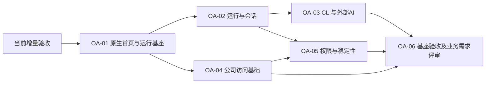

# 公司OA基座任务路线与执行跟踪

更新2026-10-30。当前增量 [#31](https://github.com/insanetoto/nuochong-page/issues/31)已由用户明确验收（“验收通过，合入集成分支”，PR #38）。以下0/6完成、0/6人工验收；仅OA-01技术收尾通过（PR44合入后Validating，待人工验收），其余Backlog，按依赖解锁。本次不自动开展六项实现或发布生产。

| 任务 | GitHub Issue | 前置 | 状态 | 负责人 | 验收 |
| --- | --- | --- | --- | --- | --- |
| OA-01 | [原生首页与独立运行基座](https://github.com/insanetoto/nuochong-page/issues/32) | 当前增量 #31 已验收 | Validating（PR44合入后） | insanetoto | 技术证据齐备，待整体人工验收 |
| OA-02 | [Harness核心运行与会话](https://github.com/insanetoto/nuochong-page/issues/33) | #32 | Backlog | 未指派 | 未实现/未验收 |
| OA-03 | [CLI与外部AI接入](https://github.com/insanetoto/nuochong-page/issues/34) | #33 | Backlog | 未指派 | 未实现/未验收 |
| OA-04 | [公司访问基础](https://github.com/insanetoto/nuochong-page/issues/35) | #32 | Backlog | 未指派 | 未实现/未验收 |
| OA-05 | [权限、稳定性与运行保障](https://github.com/insanetoto/nuochong-page/issues/36) | #33, #35 | Backlog | 未指派 | 未实现/未验收 |
| OA-06 | [基座验收与首个业务需求评审](https://github.com/insanetoto/nuochong-page/issues/37) | #34, #35, #36 | Backlog | 未指派 | 未实现/未验收 |

## 如何领取与验收

1. 阅读[任务范围](tasks.md)、[路线图](roadmap.md)与适用ADR，检查前置人工验收；前置未通过不领取实现。
2. 在Issue指派自己并记录In progress、分支、预期交付；只推进任务范围，业务功能先独立评审。
3. PR目标refactor/integration，引用Issue，提供测试命令/结果和已知限制；更新进度和证据。
4. CI通过和合并分别登记；负责人明确验收后才记Accepted/关闭为completed，并解锁后继。生产发布另行批准。

公网管理员测试上线不等于OA-01所有AC和人工验收已完成；合成HTTP客户端测试不等于OA-02/03真实联调完成。负责人以Issue实际证据为准，不把预估人日当进度。

## 历史计划处置

旧B任务#12—#19及总览#20按not_planned撤销，未交付也未验收；旧B里程碑停止执行。其内容与B—E路线保留在[历史归档](archive/business-plan-2026-10-29/roadmap.md)。A阶段#1—#10已验收历史与证据保留，不纳入本表的6项完成率。具体OA业务尚未规划。

## 最新审计入口

[2026-10-30审计](progress-2026-10-30.md)：0/6整体验收、1/6技术收尾通过、5/6未启动。测试环境已上线，不再是仅本机预览；早期缺口现已通过PR44和真实演练补齐，见最新收尾报告。已上线不等于OA-01已人工验收。

## OA-01最新收尾

[整体验收报告](oa-01-acceptance.md)：真实停止隔离、启动/重启后的工作区与原生配置保留、恢复后的认证WebSocket及版本清单均通过；PR44同步部署代码回集成分支。下方历史审计所列技术缺口已补齐，仅人工确认待完成。OA-02—06仍Backlog，0/6整体人工验收。
