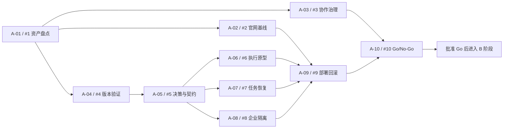

# A 阶段任务路线图与执行跟踪

更新日期：2026-10-28。此文件为创建时快照；执行期间以 GitHub 子 Issue 的负责人、执行记录与验收结论为准。

## 负责人入口

- [A 阶段总览与验收跟踪 #11](https://github.com/insanetoto/nuochong-page/issues/11)：集中查看任务、依赖和认领/验收进度，由阶段负责人维护。
- [全部 A 阶段任务](https://github.com/insanetoto/nuochong-page/issues?q=is%3Aissue%20%22%5BA-%22)：开放及已关闭任务。
- [未分配的 A 阶段任务](https://github.com/insanetoto/nuochong-page/issues?q=is%3Aissue%20is%3Aopen%20no%3Aassignee%20%22%5BA-%22)。
- [已关闭的 A 阶段任务](https://github.com/insanetoto/nuochong-page/issues?q=is%3Aissue%20is%3Aclosed%20%22%5BA-%22)：负责人需核实关闭原因和验收记录，关闭数量不自动等于验收完成数量。

## 当前状态

2026-10-29：A-01与A-02已验收并关闭，3/10完成。A-03已完成，PR #23通过双构建/E2E后合入refactor/integration，Issue #3关闭。按用户要求必需批准人数为0，其余保护已回读验证。A-04已领取并开始官方发布包验证，其余等待各自前置。Ready/Backlog 等为本项目执行状态，记录在 Issue 正文/总览中；不是已经配置的 GitHub Project 字段。Project、标签、里程碑及原生依赖仍由 A-03 落实。

## 路线与可并行波次

| 波次 | 可开展任务 | 开始条件 |
| --- | --- | --- |
| 1 | A-01 | 负责人分配成员并确认盘点范围 |
| 2 | A-02、A-03、A-04 | A-01 已验收；可并行 |
| 3 | A-05 | A-04 已验收；可与尚在进行的 A-02/A-03 并行 |
| 4 | A-06、A-07、A-08 | A-05 已验收；可并行 |
| 5 | A-09 | A-02、A-06、A-07、A-08 全部验收 |
| 6 | A-10 | A-03、A-09 验收；同时核对所有 A 任务证据 |

无成员和工作量估算前不编造起止日期。A-10 完成后重新估算 B—E；所有阶段仍在本次规划范围内。

## 分配与状态表（初始快照）

| 规划 ID / Issue | 任务 | 建议角色 | 成员 | 状态 | 前置验收 |
| --- | --- | --- | --- | --- | --- |
| [A-01 / #1](https://github.com/insanetoto/nuochong-page/issues/1) | 仓库与功能资产盘点 | 架构 | insanetoto | Done | 无 |
| [A-02 / #2](https://github.com/insanetoto/nuochong-page/issues/2) | 官网保护基线 | 前端＋测试 | insanetoto | Done | [A-01](https://github.com/insanetoto/nuochong-page/issues/1) |
| [A-03 / #3](https://github.com/insanetoto/nuochong-page/issues/3) | 协作与仓库治理初始化 | 平台 | insanetoto | Done | [A-01](https://github.com/insanetoto/nuochong-page/issues/1) |
| [A-04 / #4](https://github.com/insanetoto/nuochong-page/issues/4) | Harness 与运行版本验证 | AI | insanetoto | In progress（运行版本验证） | [A-01](https://github.com/insanetoto/nuochong-page/issues/1) |
| [A-05 / #5](https://github.com/insanetoto/nuochong-page/issues/5) | 架构决策、契约与指标冻结 | 架构＋产品 | 待分配 | Backlog | [A-04](https://github.com/insanetoto/nuochong-page/issues/4) |
| [A-06 / #6](https://github.com/insanetoto/nuochong-page/issues/6) | Harness 执行与流式原型 | AI | 待分配 | Backlog | [A-05](https://github.com/insanetoto/nuochong-page/issues/5) |
| [A-07 / #7](https://github.com/insanetoto/nuochong-page/issues/7) | 持久任务与恢复原型 | 后端 | 待分配 | Backlog | [A-05](https://github.com/insanetoto/nuochong-page/issues/5) |
| [A-08 / #8](https://github.com/insanetoto/nuochong-page/issues/8) | 企业与工具权限原型 | 后端＋测试 | 待分配 | Backlog | [A-05](https://github.com/insanetoto/nuochong-page/issues/5) |
| [A-09 / #9](https://github.com/insanetoto/nuochong-page/issues/9) | 部署、资源与回滚原型 | 平台＋测试 | 待分配 | Backlog | [A-02](https://github.com/insanetoto/nuochong-page/issues/2)、[A-06](https://github.com/insanetoto/nuochong-page/issues/6)、[A-07](https://github.com/insanetoto/nuochong-page/issues/7)、[A-08](https://github.com/insanetoto/nuochong-page/issues/8) |
| [A-10 / #10](https://github.com/insanetoto/nuochong-page/issues/10) | 架构阶段 Go/No-Go 评审 | 架构，产品/测试/发布共同审批 | 待分配 | Backlog | [A-03](https://github.com/insanetoto/nuochong-page/issues/3)、[A-09](https://github.com/insanetoto/nuochong-page/issues/9) |

## 状态维护与验收规则

1. 阶段负责人在 #11 中维护成员与执行状态；开发者领取时设置子 Issue Assignee，补充审查人、基础 SHA 与工作范围。
2. 状态依次为 Ready → In progress → In review → Validating → Done；被阻断时记录 Blocked、原因、责任人及解除条件。
3. PR 合入后仍需在集成环境逐条验收；通过后附证据和验收人，再关闭子 Issue并更新 #11 勾选框。不得把“已合并”直接计为“已验收”。
4. 每周由负责人核对：已验收/进行中/阻断数量、可解锁任务、资源缺口和决策变化；静态文档若更新，注明快照日期。
5. #11 的全部任务验收和 #10 阶段结论都完成后才能关闭总览。No-Go 时建立补充任务并关联 #11，不能自动进入 B。
6. 本次创建 Issues 只完成 A-03 的部分任务登记工作，不代表 A-03 的治理初始化已完成。

## 配套资料

- [A 阶段架构与原型方案](phase-a.md)
- [完整任务范围与验收](tasks.md)
- [个人开发上手指南](developer-onboarding.md)
- [团队协作流程](collaboration.md)

## A-01 本次执行证据

2026-10-29：已获取远程refs；[资产盘点](inventory.md)及[机器快照](evidence/A-01-inventory.json)覆盖main/test 71、main/dev 70、dev/test 9个文件差异。未修改业务或官网；用户后续已确认迁移处置，PR #21集成后Issue #1已关闭。
