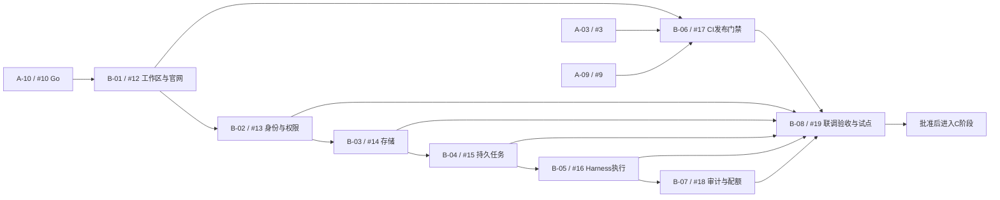

# B 阶段任务路线图与执行跟踪

日期：2026-10-28。创建时快照：0/8 已验收；A-10已获用户明确Go，B-01为Ready（待分配），其余Open/Backlog。实时状态以各 Issue 的 Assignee、执行记录和验收结论为准，由阶段负责人同步总览。

## 负责人入口

- [B 阶段总览 #20](https://github.com/insanetoto/nuochong-page/issues/20)：分配、依赖、PR与验收跟踪。
- [A 阶段准入评审 #10](https://github.com/insanetoto/nuochong-page/issues/10)：必须有明确批准的 Go 结论；仅关闭Issue不等于准入。
- [A 阶段总览 #11](https://github.com/insanetoto/nuochong-page/issues/11)。
- [未分配 B 阶段任务](https://github.com/insanetoto/nuochong-page/issues?q=is%3Aissue%20is%3Aopen%20no%3Aassignee%20%22%5BB-%22)。

## 范围和边界

本阶段把A阶段原型产品化，交付真实身份/企业权限、存储、持久任务、Harness执行与工作台、CI发布门禁、审计配额及受控试点验收。保持官网内容、视觉、交互、URL与SEO基线；不提前实现C—E的知识助手、培训或工单。技术版本/运行指标以A阶段评审结论为准。

任务全部继承A-10准入门禁；依赖验收后才从Backlog改Ready。此文不授权启动开发、修改生产权限或发布。

## 任务映射（初始状态）

| 任务 / Issue | 建议角色 | 成员 | 状态 | 前置验收 |
| --- | --- | --- | --- | --- |
| [B-01 / #12](https://github.com/insanetoto/nuochong-page/issues/12) 工作区拆分与官网无损迁移 | 前端＋平台 | 待分配 | Ready（A-10 Go） | [A-10 / #10](https://github.com/insanetoto/nuochong-page/issues/10) |
| [B-02 / #13](https://github.com/insanetoto/nuochong-page/issues/13) 身份、企业与权限 | 后端 | 待分配 | Backlog | [A-10 / #10](https://github.com/insanetoto/nuochong-page/issues/10)、[B-01 / #12](https://github.com/insanetoto/nuochong-page/issues/12) |
| [B-03 / #14](https://github.com/insanetoto/nuochong-page/issues/14) 业务持久化与文件存储 | 后端 | 待分配 | Backlog | [A-10 / #10](https://github.com/insanetoto/nuochong-page/issues/10)、[B-02 / #13](https://github.com/insanetoto/nuochong-page/issues/13) |
| [B-04 / #15](https://github.com/insanetoto/nuochong-page/issues/15) 持久任务执行器 | 后端 | 待分配 | Backlog | [A-10 / #10](https://github.com/insanetoto/nuochong-page/issues/10)、[B-03 / #14](https://github.com/insanetoto/nuochong-page/issues/14) |
| [B-05 / #16](https://github.com/insanetoto/nuochong-page/issues/16) Harness 服务与工作台 AI 运行 | AI＋前端 | 待分配 | Backlog | [A-10 / #10](https://github.com/insanetoto/nuochong-page/issues/10)、[B-04 / #15](https://github.com/insanetoto/nuochong-page/issues/15) |
| [B-06 / #17](https://github.com/insanetoto/nuochong-page/issues/17) CI 门禁与同产物发布 | 平台 | 待分配 | Backlog | [A-10 / #10](https://github.com/insanetoto/nuochong-page/issues/10)、[B-01 / #12](https://github.com/insanetoto/nuochong-page/issues/12)、[A-03 / #3](https://github.com/insanetoto/nuochong-page/issues/3)、[A-09 / #9](https://github.com/insanetoto/nuochong-page/issues/9) |
| [B-07 / #18](https://github.com/insanetoto/nuochong-page/issues/18) 审计、用量、预算与限流 | 后端＋AI | 待分配 | Backlog | [A-10 / #10](https://github.com/insanetoto/nuochong-page/issues/10)、[B-05 / #16](https://github.com/insanetoto/nuochong-page/issues/16) |
| [B-08 / #19](https://github.com/insanetoto/nuochong-page/issues/19) 基础平台验收与试点发布 | 测试＋发布 | 待分配 | Backlog | [A-10 / #10](https://github.com/insanetoto/nuochong-page/issues/10)、[B-02 / #13](https://github.com/insanetoto/nuochong-page/issues/13)、[B-03 / #14](https://github.com/insanetoto/nuochong-page/issues/14)、[B-04 / #15](https://github.com/insanetoto/nuochong-page/issues/15)、[B-05 / #16](https://github.com/insanetoto/nuochong-page/issues/16)、[B-06 / #17](https://github.com/insanetoto/nuochong-page/issues/17)、[B-07 / #18](https://github.com/insanetoto/nuochong-page/issues/18) |

## 依赖路线

图中通过 B-01 传递 A-10 门禁；表格和各 Issue 中显式列出 A-10。B-02 与 B-06 在 B-01 验收后可并行，B-06 另需 A-03/A-09。B-06先建设当时已存在的应用检查，B-05/B-07接入完整发布流水线的验证归B-08。

## 开发边界澄清

- B-02包含认证必要的最小数据库连接、身份/企业/成员表和迁移；B-03再扩展通用持久化与文件服务，避免身份依赖尚未实现的存储任务形成循环。
- B-04使用稳定执行接口与测试替身，B-05再接Harness；不得把替身测试当真实模型验收。
- B-05使用批准的Profile与适配层，不修改上游核心；Host故障不能阻断官网。
- B-07区分已知/估算/未知用量，包含并发配额竞争与日志隔离测试。
- B-08验证真实集成SHA、同产物推广、回滚、两企业隔离和全部AC；生产推广需单独批准。

## 负责人维护规则

领取时设置子Issue Assignee和审查人，补充基础SHA、范围和PR；状态按Ready→In progress→In review→Validating→Done推进，阻断另记原因、责任人和解除条件。实际合并后仍需按AC验收，再关闭子Issue并更新总览勾选框。

总览由负责人维护，不声称已经创建自动同步的GitHub Project/原生依赖。每周检查进展、阻断、可领取任务和资源缺口。全部任务验收、B-08会签通过后才能关闭阶段总览并准入C。

## 配套资料

- [完整任务清单及细化边界](tasks.md)
- [总体路线图](roadmap.md)
- [团队协作](collaboration.md)
- [个人开发指南](developer-onboarding.md)

## A-10细化更新（2026-10-29）

B任务范围/验收已吸收A阶段实测发现，逐项估算合计27–45工程人日，见[tasks.md](tasks.md)和[phase-a-review.md](phase-a-review.md)。当前仍0/8完成；用户已明确批准Go，仅B-01为Ready，其余继续按依赖执行。没有替团队虚构日历排期、成员或生产批准。
