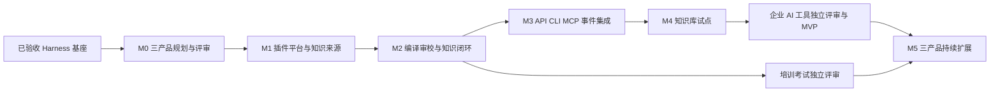

# 诺崇产品路线图：Harness 基座与三产品插件体系

## 2026-11-08 下一轮工作安排（提案）

已细化 [18项后续任务](../product/knowledge/v2/next-work.md)。优先进行v0交接/缺口核查、#85人工产品验收与#94稳定性调查、PR #99设计确认及P1契约冻结；随后由DeepSeek按依赖实现文本来源—片段审校—发布快照—图谱闭环。ChatGPT负责设计与预审，负责人保留人工验收和发布决定。AI工具与培训考试可并行开展首期设计，不提前启动其运行代码。媒体能力及其真实验收单列P2；本轮全部任务仍Planned，未创建实现Issues或授权部署。以下保留总体路线与历史状态。

更新：2026-11-01。负责人明确公司三条产品线：**企业知识库、企业 AI 工具、培训和考试**，统一使用 DeepSeek Harness 技术基座，通过插件扩展业务。部门、人员、角色权限作为共享插件组合使用，详见[统一组织与权限设计](../product/shared-access/design.md)。知识库优先，以规章制度为首个知识域，采用 LLM Wiki 持续编译/审校/维护思路，并提供外部集成能力。

本轮已形成[整体规划设计成果](../product/README.md)、[三产品技术路线](../product/portfolio.md)、[知识库详细设计](../product/knowledge/design.md)、[页面设计](../product/knowledge/pages.md)、[可点击原型](../product/prototypes/knowledge.html)和[任务计划](../product/tasks.md)。**用户随后授权知识库初版建设；已按 [KBV0-01—07 台账](../product/v0/tasks.json) 依次实施。** 已有真实业务 API/工作台，初版范围和工程证据见 [v0 基线](../product/v0/README.md)；人工产品验收仍待负责人确认。

## 已交付与当前边界

| 范围 | 真实状态 | 剩余边界 |
| --- | --- | --- |
| OA-01—OA-06 基座 | 6/6 已人工验收，OA-06 有限 Go | 非全员 OA 或全部生产容量 Go |
| 官网 | main/test 已发布，官网独立 | 新产品壳不修改已批准官网基线 |
| 原生管理员演示 | 账号登录已部署，真实登录/HTTPS Cookie/WS 与远程 CI 通过；[PR #66](https://github.com/insanetoto/nuochong-page/pull/66) | 仍为管理员身份，不能直接授予普通员工 |
| 演示模型体验 | DEMO-01 已配置公司凭据、关闭模型引导并初始化演示工作区，实际账号真实模型回答通过 | [交付证据](../product/demo-delivery.md)；管理员演示不等于员工产品壳 |
| 控制 API / CLI / MCP | 59 项基座与产品 CLI 契约、公司身份与受限 MCP 已实施验证 | 知识库隔离测试已部署并验证；公司账号已实现，SSO/生产发布待做 |
| 三产品体系与 Wiki 初版 | 已有真实来源/知识修订、审校发布、检索问答与工作台 | AI 工具、培训考试仍 planned；原静态原型仅用于设计对照 |

基座限制保留于 [OA-06 评审](oa-06-foundation-review.md)与 [OA-05 报告](oa-05-acceptance.md)。历史 B—E 业务演示继续撤销，不能自动迁回。ADR-011 是本轮 Proposed 方案，不冒充既有 Accepted 决策。

## 里程碑与执行出口

| 里程碑 | 对应任务 | 状态 | 交付和验收出口 |
| --- | --- | --- | --- |
| M0 产品体系与方案 | 本轮文档、原型；KB-01/PLAT-01 评审 | 设计已形成，待评审 | 产品边界、权限/制度规则、插件契约、页面、数据/API/CLI 和依赖得到确认 |
| 演示体验修整 | DEMO-01 | 已实施，人工验收待下一轮 | 访客无需 DeepSeek 登录/个人 Key；服务端公司模型实际可用；失效明确不可用，不转 BYOK |
| M1 公共平台与知识来源 | PLAT-02/03、IAM-01—IAM-04、KB-02—KB-06 | 初版切片已实现 | 插件生命周期、共享组织/人员/角色管理、员工身份壳、来源/解析/受限编译，AI 生成候选而非自动发布 |
| M2 可信知识闭环 | KB-07—KB-13 | 初版切片已实现 | 审校发布、当前有效制度、中文检索、浏览/原文核验、有依据问答与质量维护；权限/撤回负例通过 |
| M3 开放集成与运营 | KB-14—KB-16 | API/CLI/MCP 已实现，事件投递/连接器 planned | REST/CLI/MCP、签名事件、同步/导出与审计；没有厂商连接器伪成功 |
| M4 知识库试点 | KB-17/18 | 初版工程验证已过，隔离测试已部署并验证；人工验收待确认 | 质量、恢复、容量、真实数据授权和人工产品验收；生产发布单独记录 |
| T1 企业 AI 工具 | TOOL-01/02 设计→后续实现 | planned | 先选择首个办公痛点，再交付版本化工具、授权执行、审批、产物和审计 |
| L1 培训和考试 | LEARN-01/02 设计→后续实现 | planned | 已发布知识快照→课程题库→审核→学习/考试→确定性评分与人工评阅；单独产品验收 |
| M5 扩展与规模化 | 三产品后续 | planned | 根据质量/规模选择检索优化、首个厂商连接器、工具组合、学习路径；不先承诺微服务和向量集群 |

原完整规划共 30 项任务，初版另外拆分 7 个顺序 Issue #71—77；初版切片不等于完整原任务全部验收。原规划中含 IAM-01—IAM-04 四项共享组织/权限任务。依赖以[任务表](../product/tasks.md)为准；可并行任务不等于自动开工。知识库和平台实现的工程人日建议见任务表，非日历承诺。可执行能力清单只注册实际交付的 59 项命令；完整计划契约继续独立，不伪造完成率。

## 本轮明确的架构方向

- 知识库主题参考官网品牌蓝/青色、Logo、字体栈与卡片按钮，产品布局与官网独立。
- 部门、人员和角色权限统一封装为共享插件；产品仅声明自己的资源与权限点，最终授权由可信核心执行，不复制三套组织系统。
- 平台是一个受控 Harness 基座和公共领域服务；三产品是插件。业务插件通过服务端 API/事件协作，不直接读其他插件数据表。
- 企业 Wiki 保留原始来源，模型生成可版本化知识页、目录、链接和维护建议；企业增加审批、来源有效期、权限交集和即时失效。制度原文是权威依据。
- 员工 Web、CLI、外部 AI/MCP 同权，复用版本化 commandId/schema；模型和文档不能提权。原生 owner 仅保留管理员演示。
- 公司统一提供模型，访客不自备 Key；密钥不出服务端。当前演示和将来全员产品分别验收。
- 2026-11-02：三产品设计采用统一本体方法（上层/共享/产品/租户扩展四层），知识图谱是发布快照的权限投影，不引入图数据库；知识库 v2 设计已形成但全部 planned，见 [本体方法](../product/ontology/README.md)、[知识库 v2](../product/knowledge/v2/README.md)与 [ADR-012](../adr/ADR-012-product-ontology-and-knowledge-graph.md)（Proposed）。
- 下一轮统一确认制度归口/发布人、格式和规模、密级、身份源、首个外部系统与页面反馈；本轮采用建议默认值完整落稿，不用逐项澄清阻塞成果。

## 基座验收记录

| 任务 | 结果 | 主要证据 |
| --- | --- | --- |
| [OA-01 #32](https://github.com/insanetoto/nuochong-page/issues/32) | Accepted | 原生首页和测试环境隔离，用户人工验收 |
| [OA-02 #33](https://github.com/insanetoto/nuochong-page/issues/33) | Accepted | 正式控制 API、持久 Worker 与真实模型验证 |
| [OA-03 #34](https://github.com/insanetoto/nuochong-page/issues/34) | Accepted | CLI、受限 MCP 与真实 DeepSeek 集成 |
| [OA-04 #35](https://github.com/insanetoto/nuochong-page/issues/35) | Accepted | 最小公司身份、资源归属及撤权 |
| [OA-05 #36](https://github.com/insanetoto/nuochong-page/issues/36) | Accepted | 隔离恢复演练、审计与集成必需门禁，限制见报告 |
| [OA-06 #37](https://github.com/insanetoto/nuochong-page/issues/37) | Accepted / 有限 Go | 同版本基座验证、首个业务方向评审；非生产 Go |

用户于 2026-10-30 明确批准“有限 Go 并验收 OA-06”。当前仅用于进入知识库设计；原始任务及历史证据仍见[任务范围](tasks.md)、[OA 执行跟踪](oa-tracking.md)和[历史归档](archive/business-plan-2026-10-29/roadmap.md)。
