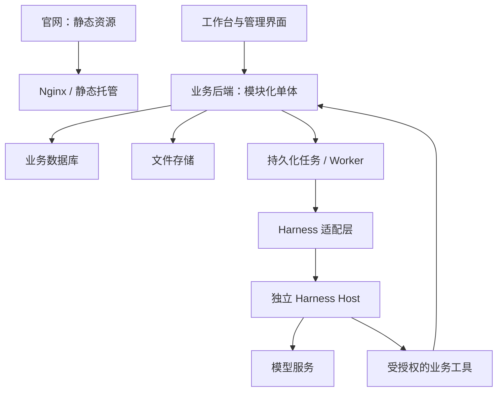

# 全阶段产品与架构路线图

状态：规划提案；A—E 全部属于本次重构范围。基线来自本地 main 提交 `46ab969`，并非对远程最新状态的保证。

## 1. 现状与目标

现状：官网由 `static-src/` + Vite 输出静态站；完整测试应用使用 vinext/Cloudflare Worker。`app/app/` 中存在模拟认证、模拟员工数据；D1/R2 未启用。远程 test 分支有独立业务更新，须在 A-01 重新获取并盘点。当前部署与 CI 是独立工作流，生产部署没有显式等待 CI 完成。

目标：在官网体验保持基线的前提下，建立真实业务平台、知识助手、培训闭环与受控自动化；支持独立发布、版本追踪、企业数据隔离及 AI 成本治理。

## 2. 目标形态

业务模块：identity、knowledge、training、workorders、ai-runs。数据库是业务事实来源；Harness 会话是执行过程来源，通过业务 runId 关联，不混为同一状态机。官网不依赖 API/Host 启动或响应。

## 3. 全阶段计划与出口

| 阶段 | 产品交付 | 工程范围 | 出口证据 |
| --- | --- | --- | --- |
| A 架构验证 | 可评审的迁移蓝图和最小原型 | 官网基线、分支盘点、决策、目录、契约、运行时与隔离原型、协作流程 | A-10 评审通过；所有阻断项有实测结果 |
| B 真实基础平台 | 用户可登录工作台、发起并追踪 AI 请求 | 工作区拆分、身份/企业隔离、业务库、文件存储、持久任务、Harness 集成、CI 发布门禁、审计与配额 | B-08：两企业测试夹具隔离通过；任务失败/取消/恢复通过；官网回归通过 |
| C 企业知识助手 | 上传资料、查看处理状态、带引用问答、反馈 | 版本化文档、解析索引、权限检索、回答与来源、会话记录、评测和成本报表 | C-06：固定评测集达到冻结指标；撤权和删文档后不可检索；试点验收 |
| D 智能培训闭环 | 课程/题目草稿、审核发布、学习、考试、报告 | 课程与题库版本、AI 辅助生成、审核、学习进度、考试评分、报告权限 | D-05：完整教学流程通过；AI 草稿不能绕过人工审核发布 |
| E 受控业务自动化 | 工单助手、外部连接、审批执行、多步骤 Agent | 工单领域、连接器、执行授权、幂等与补偿、编排、备份恢复与最终发布演练 | E-06：重试不重复写入；权限撤销及时生效；恢复和回滚演练通过 |

每阶段出口均由产品、架构、测试、发布负责人签字或在对应 Issue 中明确批准。失败不以“后续补测”替代；拆分问题为阻断/非阻断，阻断项关闭后才能进入下一阶段。

## 4. 范围边界

全阶段包含：官网保护、身份与权限、企业作用域、知识、培训、工单、AI 工具、执行追踪、用量与预算、CI/CD、数据迁移及恢复。

暂不包含：公开插件市场、任意用户上传并执行插件、完整 SaaS 计费/套餐、自建基础模型、移动原生客户端、无约束自主执行。新增上述内容通过范围变更 Issue 审批，不能混入基础迁移 PR。

首发建议单企业试点，但从 B 阶段建立企业作用域，自动化测试至少使用两个企业。若决定同时服务多个客户，需在 A-05 提升租户运营、隔离压测和容量要求，并重新拆任务。

## 5. 迁移与发布

1. 盘点 main/dev/test 的真实差异，对现有业务页面逐项决定保留、迁移、替换；不覆盖 test 分支。
2. 官网先建立文本、图片、SEO、交互、桌面/移动截图基线，再搬目录，原 URL 不变。
3. 新业务在独立测试运行环境部署；现有 Worker 在替代环境验收前保留。
4. 每次候选发布生成不可变版本清单：Git SHA、产物摘要、Harness 版本、Profile 摘要、数据库迁移版本。
5. 测试验证与生产推广使用同一批已验证产物；环境配置和凭据分别注入。
6. 数据库采用兼容性迁移；破坏性删字段延后到兼容窗口结束。回滚应用不等于回滚数据，单独验证备份和恢复。

## 6. 风险和应对

| 风险 | 处理与责任任务 |
| --- | --- |
| Harness 升级破坏适配 | 锁定版本、用窄接口封装、契约与重放测试；A-04/A-06、B-05 |
| 模拟后台被误当真实认证 | B-02 替换；CI 禁止生产启用模拟身份和明文演示口令 |
| 文档提示词注入或工具越权 | 文档为不可信输入；模型提供的企业/资源字段不作为授权依据；A-08、C-03、E-03 |
| 长任务中断或重复写入 | 持久任务、执行租约、幂等键、重试和结果去重；A-07、B-04、E-03 |
| 测试与生产技术栈偏离 | 新业务环境统一运行方式，独立验证官网；B-06 |
| 模型延迟、费用或供应商异常 | 请求超时、并发/用量限制、成本记录、受控恢复；B-07/C-06 |
| 后续需求导致过度拆分 | 按模块边界交付；仅有明确隔离或容量需求再拆服务 |

各阶段任务及完整依赖见 [任务清单](tasks.md)；A 阶段指标冻结与技术决策见 [详细方案](phase-a.md)。
