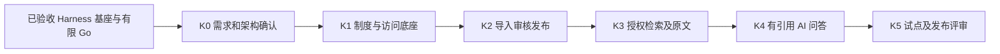

# 公司 OA 产品路线图：Harness 基座与制度知识库

更新：2026-10-30。产品以 DeepSeek Harness 为 AI 基座，公开官网独立，原生 Harness Web 暂作管理员 OA 首页。首个业务方向由用户确定为**面向公司全员的规章制度知识库**：先纳入公司的规章管理制度，为后续 OA 功能提供制度依据。

OA 基座六项任务已人工验收，负责人批准的 OA-06 **有限 Go**仅允许基于现有基座进入知识库设计。下述知识库阶段和验收出口是路线建议，具体功能、授权规则、工期和生产发布仍需单独确认；尚未实现的能力均为 planned。

## 当前状态与边界

| 范围 | 现状 | 边界 |
| --- | --- | --- |
| 公开官网 | 保持已批准的内容、视觉、URL 和 SEO 基线 | 官网与 OA 独立；修改基线需另行产品确认 |
| 临时 OA 首页 | 官方 Harness 原生 Web 已在管理员测试环境验证 | 原生 owner 具有管理能力，不直接授予普通员工；未形成统一员工 Web 身份 |
| 控制 API 与运行 | PostgreSQL 权威状态、受限官方 SDK、会话和任务恢复已验收 | 真实模型与故障合成测试分开记录；新控制 API 尚未公网发布 |
| 公司访问基础 | 管理员签发受限凭据，服务端实施身份、作用域和资源归属 | 外部企业 SSO 尚未接入；管理员不会自动读取他人私有会话 |
| CLI / 外部 AI | 22 项 CLI 契约、受限 MCP stdio 和真实 DeepSeek 调用已验证 | MCP 流式事件仍由 CLI 提供；未来能力须复用服务端授权和领域规则 |
| 运行保障 | 隔离容器故障、合成数据恢复和必需 CI 门禁已验证 | 无已批准 Linux 像素基线；生产容量、真实故障与完整灾备仍需验证；模型费用 unknown |
| 制度知识库 | 已形成[需求评审草案](oa-06-knowledge-discovery.md) | 尚未实现、导入真实制度或批准具体功能；不恢复旧业务演示 |

完整基座证据及有限 Go 限制见[OA-06 评审](oa-06-foundation-review.md)、[OA 任务跟踪](oa-tracking.md)与[OA-05 演练报告](oa-05-acceptance.md)。历史 B—E 业务计划已撤销并归档，不能作为自动迁移或开发授权。

## 阶段路线

| 阶段 | 状态 | 建议交付 | 前置与退出条件 |
| --- | --- | --- | --- |
| 基座 OA-01—OA-06 | **已验收** | 官网隔离、原生管理员首页、正式控制 API、身份、CLI/MCP、故障验证和有限 Go | 用户已逐项确认；不代表全员 OA 或生产就绪 |
| K0 需求与架构设计 | **当前：允许设计** | 确认制度来源、使用者、归口/发布人、可见范围、版本和有效期规则；形成数据、权限、发布流程、接口、CLI 与验收方案 | 产品负责人确认具体范围和规则后，才拆解/领取实现任务 |
| K1 访问与制度底座 | planned | 按已确认规则设计并实现制度元数据、版本、状态及统一资源授权；选定员工访问入口 | K0 已确认；API/CLI 同权、未授权访问拒绝，原生 owner 不向员工下放 |
| K2 导入、审核与发布 | planned | 合成制度导入，按确认后的流程审核、发布、撤回及保留版本；操作审计和恢复 | K1 已验收；写操作有版本化契约、明确幂等和审批语义，草稿及撤回版本不可越权读取 |
| K3 授权检索与原文核验 | planned | 可见范围内检索现行制度，显示原文位置、版本、生效日期和来源 | K2 已验收；搜索与原文权限一致，过期或撤回制度不能误作现行依据 |
| K4 基于制度的 AI 问答 | planned | 通过受控 Harness 检索可访问的现行内容，回答附可核验来源和版本；依据不足明确说明 | K3 已验收；答案及引用不泄露无权限内容，不能替代制度发布和人工审批 |
| K5 试点与发布评审 | planned | 使用合成数据完成全链路、故障、权限和运维验证，评审试点及数据导入方案 | K1—K4 各自验收；真实制度导入、试点范围及生产部署须经负责人单独批准 |

阶段顺序是依赖关系，不是日历承诺。K0 完成前不估算实现工期、不将 planned 功能登记为已交付。后续 OA 业务应先评审用户痛点、数据、角色和验收，再独立规划；制度知识库可在通过授权与版本校验后为其他业务提供制度依据。

## K0 需要确定的决策

1. **制度来源与范围**：首批权威来源、文档格式和数量；哪些制度对全员可见，哪些需要部门或密级限制。
2. **责任与发布**：制度归口人、审核与发布角色；是否允许同一人审核和发布、撤回或紧急修订如何处理。
3. **有效版本**：唯一编号、版本变更、生效和失效时间；制度冲突的裁决人、历史版本的员工可见策略。
4. **员工入口与身份**：如何把全员访问接入公司身份；当前管理员原生 Web 不能作为全员授权模型。SSO、Web 体验和控制 API 部署方式另行设计。
5. **检索与回答**：引用需精确到何种原文位置；无依据或冲突时如何提示、是否要求人工确认；性能、质量和用量目标如何测定。
6. **交付与运维**：真实制度导入和更新流程、审计保留、备份恢复、试点用户、验收责任人及可用资源。

上述事项的具体答案尚未获确认；[需求草案](oa-06-knowledge-discovery.md)中的功能与权限策略均须在 K0 评审，不将默认建议当成已批准的制度。

## 通用交付要求

- 所有新增或变更产品能力先定义版本化 commandId、输入/输出 schema、CLI 映射、权限与副作用；Web、CLI、未来 MCP 复用同一 API 和授权，不直连数据库或开放 Harness owner 接口。
- 制度内容、搜索索引、引用片段和 AI 回答遵循同一服务端资源权限；写操作的审核与幂等不能被模型、`--yes` 或 dry-run 绕过。未实现能力明确标记 planned。
- 测试使用合成制度，不提交密钥、原始公司资料或可识别日志。逐项记录实现、测试、人工验收、合并与发布；生产配置和 main/test 发布需独立授权。
- AI 回答必须能追溯到授权的制度版本与来源；证据不足或制度冲突时，按 K0 确认的规则提示或交由负责人处理。

## 基座验收记录

| 任务 | 结果 | 主要证据 |
| --- | --- | --- |
| [OA-01 #32](https://github.com/insanetoto/nuochong-page/issues/32) | Accepted | 原生首页和测试环境隔离，用户人工验收 |
| [OA-02 #33](https://github.com/insanetoto/nuochong-page/issues/33) | Accepted | 正式控制 API、持久 Worker 与真实模型验证 |
| [OA-03 #34](https://github.com/insanetoto/nuochong-page/issues/34) | Accepted | CLI、受限 MCP 与真实 DeepSeek 集成 |
| [OA-04 #35](https://github.com/insanetoto/nuochong-page/issues/35) | Accepted | 最小公司身份、资源归属及撤权 |
| [OA-05 #36](https://github.com/insanetoto/nuochong-page/issues/36) | Accepted | 隔离恢复演练、审计与集成必需门禁，限制见报告 |
| [OA-06 #37](https://github.com/insanetoto/nuochong-page/issues/37) | Accepted / 有限 Go | 同版本基座验证、首个业务方向评审；非生产 Go |

用户于 2026-10-30 明确批准“有限 Go 并验收 OA-06”。当前仅用于进入知识库设计；原始任务及历史证据仍见[任务范围](tasks.md)、[OA 执行跟踪](oa-tracking.md)和[历史归档](archive/business-plan-2026-10-29/roadmap.md)。
