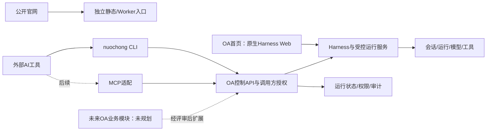

# 公司OA产品路线图：以DeepSeek Harness为基座

更新：2026-10-30。替代旧企业知识库/培训/工单B—E路线。产品定位：先建立可用、可扩展的OA技术基座，临时以官方Harness原生页面作为OA首页，再按公司的实际需求规划业务功能。当前不预设审批、考勤、HR、知识库或工单模块。

## 当前交付与产品边界

| 内容 | 当前状态 |
| --- | --- |
| 公开官网 `/` | 文案、图片、交互及SEO保持原基线 |
| 旧业务入口/模拟登录/员工管理 | 源码与样式移除，`/app`及原子路由返回404 |
| OA临时首页 | 管理员测试环境已上线；Node24.21.0 / dsh0.2.1-rc.2，独立常驻服务，真实公网登录/WebSocket验证通过 |
| 官网 `/oa` | 测试Worker已验证307跳转至https://www.nuochong.net/oa-test/；目标无启动凭据，未配置仍503 |
| CLI | 22项CLI契约已与正式OA API联调；MCP/真实外部AI集成待OA-03 |
| Harness已有技术验证 | 保留SDK、流、任务租约、权限与部署实验作为工程证据，不把实验企业夹具当产品业务 |
| 具体OA业务模块 | 尚未规划；下一轮需求评审后单独建任务，不自动恢复旧业务路线 |

官网中的产品介绍仍作为现有营销内容保留，不等于其业务功能已经实现。用户已单独授权合入test并部署原生测试环境；PR #39—#42已合并，main未发布。原生测试服务复用现有服务器和www证书下的独立/oa-test/路径，官网静态内容保持原基线。

## 基座形态

原生Harness Web当前作为受认证保护的公网测试管理员入口，不把其owner配置/工具权限直接授予普通员工。正式公司入口须先落实身份和作用域。CLI/API/MCP复用同一能力契约；不复制业务规则、不用shell拼接模型输入。

## 六个实施任务

| 任务 | 交付 | 前置 | 初步工程人日 |
| --- | --- | --- | --- |
| OA-01 原生首页与独立运行基座 | 将本次启动器落成可部署独立服务、版本清单、工作区/状态目录、官网分离；正式入口可配置、凭据不进入URL配置或前端包 | 当前范围/基础增量验收 | 3–5 |
| OA-02 Harness核心运行与会话 | 创建/查询/取消、会话历史、模型/工具配置接口；持久状态、上游终态映射、只读默认工具和故障恢复 | OA-01 | 4–7 |
| OA-03 CLI与外部AI接入 | 当前客户端接正式API，扩展session/model/tool/runtime命令；同一契约的受限MCP适配及至少一个真实集成记录 | OA-02 | 3–5 |
| OA-04 公司访问基础 | 最小调用方身份、员工可见范围/管理员边界、会话/资源归属、凭据撤销；不建设员工档案/部门管理业务 | OA-01，可与OA-02并行 | 3–5 |
| OA-05 权限、稳定性与运行保障 | 跨入口授权、模型/工具能力、并发/超时/用量、审计、Host/Worker恢复、镜像发布与独立恢复 | OA-02、OA-04 | 3–5 |
| OA-06 基座验收与首个业务需求评审 | 官网无回归；原生OA首页＋正式API/CLI＋外部AI完整演练；形成基础版本和下一轮需求清单 | OA-03、OA-04、OA-05 | 2–3 |

合计18–30工程人日，假设1名熟悉仓库的开发者使用Codex并有正常评审支持；不是日历承诺，不含外部身份账号、域名和部署资源等待。每阶段根据实测重新估算。旧A-10的85–141人日对应已撤销范围，不适用于本路线。

安全不延后：OA-01/OA-02只能在受控环境或已授权调用方运行；OA-04提供正式公司身份与员工边界，OA-05强化可靠性，不表示此前可以开放无鉴权接口。

## 推进顺序和阶段出口

1. 本次先完成清理、真实原生页面预览、CLI基础和路线图；用户已验收基础增量，随后授权测试上线；OA-01已整体验收，OA-02/OA-03/OA-04已整体验收，OA-05 Accepted、OA-06 In review，不自动开始六项全部实现。
2. 先跑通Harness核心与身份，再完成CLI/MCP真实调用；OA首页继续复用原生页面，暂不开发自定义业务仪表盘。
3. OA-06通过后，先选择公司一个真实痛点，写业务范围/角色/数据/CLI命令和验收标准，再决定首个业务模块。不能因旧原型曾存在就自动迁回员工、培训、知识或工单。
4. 公司发布与生产推广必须有独立批准；原生owner页面不得直接作为全员权限模型。

执行范围与验收见[tasks.md](tasks.md)，跟踪见[oa-tracking.md](oa-tracking.md)，CLI要求见[cli-native.md](cli-native.md)。旧计划保存在[归档](archive/business-plan-2026-10-29/roadmap.md)；A阶段验证记录保留，其Go仅作为历史技术证据，不继续授权旧业务范围。

## 2026-10-30任务完成审计

| 任务 | 实现/技术验证 | 人工验收 | 当前状态 |
| --- | --- | --- | --- |
| OA-01 #32 | 原生页面/部署、启停隔离、工作区与profile保留、恢复后认证WS均通过；见最新整体验收报告 | 2026-10-30用户验收通过 | Accepted |
| OA-02 #33 | 正式API/持久Worker/SDK恢复与真实模型验证通过，PR46合入 | 2026-10-30用户验收通过 | Accepted |
| OA-03 #34 | 22项CLI与正式API联调；受限MCP和真实DeepSeek调用通过 | 2026-10-30用户验收通过 | Accepted |
| OA-04 #35 | 正式opaque凭据/角色/资源归属与撤权已实现 | 2026-10-30用户验收通过 | Accepted |
| OA-05 #36 | 隔离容器/权限/恢复/门禁验证通过 | 2026-10-30用户验收通过 | Accepted |
| OA-06 #37 | 同版本基座验证与制度知识库需求草案已形成 | 待负责人评审 | In review |

当前5/6整体验收完成（OA-01至OA-05），OA-06未验收。不以文件数、PR数或历史A阶段结果折算完成率。原18–30工程人日为初始总量估算，不能直接当作剩余工期；后继任务领取前重新估算。

PR44已完成部署历史回流，用户已明确OA-01整体验收。OA-02与OA-04已实施并获用户整体验收；CLI/MCP与稳定性任务仍按依赖推进，本次不自动开工。当前不启动业务模块或发布main。

完整证据、未完成项与分支差异见[任务完成审计](progress-2026-10-30.md)。

## OA-01收尾更新（同日，覆盖上方早期审计状态）

[PR44与整体验收报告](oa-01-acceptance.md)已补齐真实启停隔离、重启工作区/profile持久性、恢复后公网认证/WS及实际版本/限额证据；PR44回流test部署历史。OA-01已于2026-10-30获用户明确确认“OA-01 验收通过”，原早期审计缺口作为历史保留。该次解锁时仅OA-02与OA-04 Ready；当前实施状态见上表及下方交付记录。后续五项范围/依赖和初步估算不变。

## OA-02 / OA-04本次交付

正式控制API与独立Worker在apps/control-api，保留PostgreSQL17.11权威状态，通过官方受限SDK执行；当前公司身份方案为真实管理员签发的opaque凭据（非mock/合成issuer），每请求校验数据库权限，服务账号不得提升为admin。22项能力均有共享schema与CLI映射；真实模型与合成故障分开验证。详见两项验收报告。

当前新API只在隔离本机/CI验证，未额外发布公网或开放原生owner给员工。2026-10-30用户在会话中明确确认：“OA-02、OA-04 均验收通过”。 两项整体人工验收均已通过，OA-03与OA-05设Ready；OA-06仍等待其余依赖，不自动开工。外部企业SSO及完整运营/灾备不在本次冒称完成；MCP已有受限stdio实现。

2026-10-30用户明确确认“OA-03 验收通过”，PR49已合入；OA-05实施中，OA-06等待OA-05。首个后续业务方向为公司规章制度知识库，待OA-06评审范围后另行规划。

2026-10-30用户确认“OA-05 验收通过”；OA-06前置已满足。首个业务方向为全员使用的规章制度知识库，先评审范围和验收，不自动建设业务模块。

OA-06同版本验证及制度知识库范围建议见[基座评审](oa-06-foundation-review.md)和[需求草案](oa-06-knowledge-discovery.md)；基座有限Go、具体业务范围和生产发布分别由负责人决定。
