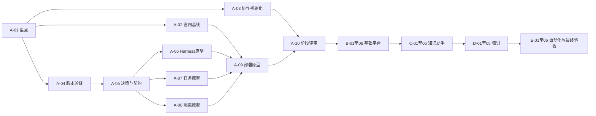

# 实施任务清单

状态：A 阶段已创建 Issues #1—#10，总览为 #11，具体映射见 [A 阶段执行路线图](phase-a-tracking.md)。2026-10-29：A-01、A-02已验收关闭；A-03由insanetoto领取，强制保护已配置并验证，待任务验收与最终CI；A-04已具备前置，其余等待依赖。B 阶段已创建 Issues #12—#19，总览 #20，均 Backlog、未分配，映射见 [B 阶段执行路线图](phase-b-tracking.md)；C—E 尚未创建对应 Issues。编号在规划内稳定；迁入 GitHub 后维护“规划 ID→Issue URL”，依赖以本 ID 表达。每项默认一个负责人和一个主 PR，验收证据附在对应 Issue/PR。

## 执行规则与依赖

“依赖”指先决任务已验收；契约协作可在 PR 中讨论，不能以未合入实现作为已完成依赖。A—E 阶段分别设置里程碑，阶段出口是硬门禁。角色简称：架构、前端、后端、AI、平台、测试、产品；具体人员在启动会议指派。

完整依赖以下方任务为准。跨阶段仅允许设计讨论提前开展，不能跳过阶段评审发布。

## A：架构验证（10 项）

### A-01 仓库与功能资产盘点
- 负责人：架构；依赖：无。
- 范围：获取经授权的远程 refs，比较 main/dev/test，列出现有路由、UI、模拟数据、API、配置、部署和已知问题。
- 交付：`docs/refactor/inventory.md`、基线 SHA、逐功能迁移映射；不合并分支。
- 验收：test 独有功能逐项标注保留/替换/暂缓及目标任务，产品与模块负责人确认；无法读取远程时明确阻断。

### A-02 官网保护基线
- 负责人：前端＋测试；依赖：A-01。
- 范围：建立中英文正文/资源/SEO清单、语言切换及导航流程、桌面与移动截图夹具。
- 交付：`tests/visual/` 原型与基线说明、内容清单；不修改官网内容。
- 验收：干净环境可复现；覆盖 phase-a.md 中官网矩阵；产品人工核对基线，无未解释差异。

### A-03 协作与仓库治理初始化
- 负责人：平台；依赖：A-01。
- 范围：落实 collaboration.md，复用已创建的 A 阶段 Issues，补齐经批准的里程碑、后续 Issues 和任务映射、Issue/PR 模板、CODEOWNERS 和简洁 AGENTS.md；组织审查分工。
- 交付：模板及规则 PR、GitHub 设置清单和实际启用证据；不擅自更改仓库权限。
- 验收：用一条文档任务试走领取→Codex实现→PR→人工审查；记录 required checks 的真实名称；管理员确认规则生效，缺少仓库权限须标记阻断。

### A-04 Harness 与运行版本验证
- 负责人：AI；依赖：A-01。
- 范围：比较官方支持的 SDK/Profile 集成方式，检查发布版本、许可证、Node 要求及依赖安装。
- 交付：`experiments/phase-a/runtime/`、精确版本清单、ADR-004 草案；不复制修改上游核心。
- 验收：干净环境按说明启动具名 Profile；版本可锁定；明确升级方式和不支持能力；无客户数据/凭据入库。

### A-05 架构决策、契约与指标冻结
- 负责人：架构＋产品；依赖：A-04。
- 范围：定稿 ADR-001—008、身份/数据/执行边界、API 与事件 schema、部署拓扑、容量和费用目标。
- 交付：`docs/adr/`、`experiments/phase-a/contracts/`、`docs/refactor/acceptance-targets.md`。
- 验收：每项有备选及理由；契约含授权、错误、取消、重连和幂等；所有原型指标有数值与测量方法；负责人批准。原型失败后允许带原因修订，再重测。

### A-06 Harness 执行与流式原型
- 负责人：AI；依赖：A-05。
- 范围：自有适配层原型、真实模型请求、只读工具、流式跟踪、取消、超时、断连及插件卸载。
- 交付：隔离原型与 `experiments/phase-a/results/runtime.md`。
- 验收：phase-a.md 对应矩阵全部有实际结果；无私有 SDK 导入；真实冒烟与 mock 分开；取消后不发起新工具调用，事件去重可验证。

### A-07 持久任务与恢复原型
- 负责人：后端；依赖：A-05。
- 范围：用所选数据库验证任务状态、租约、重试、幂等、取消竞争与双 Worker；用假执行器，不依赖 A-06 内部实现。
- 交付：任务原型及故障注入报告。
- 验收：Worker 崩溃后按冻结时限恢复；终态唯一；无任务丢失；同幂等键模拟副作用只发生一次；无法保证的外部写入列为人工补偿。

### A-08 企业与工具权限原型
- 负责人：后端＋测试；依赖：A-05。
- 范围：两个企业的文档、会话、运行和工具授权；测试伪造 tenantId、资源ID、撤权及无批准执行。
- 交付：隔离测试夹具、威胁边界说明及结果。
- 验收：所有越权请求拒绝且无副作用；日志可关联 requestId；不信任模型身份字段；Harness 宿主 owner 权限不直接授予终端用户。

### A-09 部署、资源与回滚原型
- 负责人：平台＋测试；依赖：A-02、A-06、A-07、A-08。
- 范围：测试环境启动 API/Worker/Host，验证流式代理、资源限额、Host 停机、同产物推广及回滚；不用生产。
- 交付：环境模板、演练报告、版本清单样例。
- 验收：官网在 Host 停机期间通过基线；API 明确返回 AI 故障；限额生效；能够还原上一版本；前端产物及日志无密钥。

### A-10 架构阶段 Go/No-Go 评审
- 负责人：架构，产品/测试/发布共同审批；依赖：A-03、A-09。
- 范围：汇总 phase-a.md 全部清单，关闭阻断项，修订 B—E 任务范围与估算。
- 交付：`docs/refactor/phase-a-review.md`，包含结论、批准人员、证据链接、遗留风险和任务变更。
- 验收：所有 A 任务验收完整；核心 ADR Accepted；Go 才能将 B-01 标为 Ready；No-Go 必须列补充任务和再次评审条件。

## B：真实业务与 AI 基础（8 项）

### B-01 工作区拆分与官网无损迁移
- 负责人：前端＋平台；依赖：A-10。
- 范围：落地已批准目录/包管理；迁移官网入口及素材、工作台路由；不改变文案或顺带重新设计。
- 交付：可独立构建官网及工作台的工作区与路径映射。
- 验收：A-02 基线通过；旧 URL/SEO 保持；旧后台功能清单有落点；各包依赖方向检查通过。

- 实施边界：只迁移目录、入口和构建，不重设计UI；存量功能按A-01映射处理。
- 追加验证：干净环境安装并分别构建官网/工作台；中英文、1440×900与390×844视觉、交互、SEO与原URL对照A-02基线。
- GitHub：[B-01 / #12](https://github.com/insanetoto/nuochong-page/issues/12)；状态Backlog，等待A-10 Go及依赖验收。

### B-02 身份、企业与权限
- 负责人：后端；依赖：A-10、B-01。
- 范围：真实身份认证、成员/角色、服务端会话、企业作用域及资源授权；移除生产模拟登录。
- 交付：identity 模块、迁移、登录/退出 UI、两企业测试。
- 验收：会话失效/撤权有效；匿名接口和跨企业越权被拒；生产无法启用演示口令或 mock token。

- 实施边界：本任务包含认证所需的最小数据库连接、身份/企业/成员表及迁移；B-03在此基础上扩展通用存储，不形成循环依赖。
- 追加验证：用两个企业验证登录、退出、过期/撤权与伪造tenantId；演示口令、mock token不能在生产启用；客户端不暴露服务端密钥。
- GitHub：[B-02 / #13](https://github.com/insanetoto/nuochong-page/issues/13)；状态Backlog，等待A-10 Go及依赖验收。

### B-03 业务持久化与文件存储
- 负责人：后端；依赖：A-10、B-02。
- 范围：业务库、版本化迁移、授权上传下载、存储元数据与企业归属；不实现文档语义索引。
- 交付：persistence 模块、文件服务、备份/恢复脚本。
- 验收：两企业读写/下载隔离；非法格式/大小拒绝；空库迁移和旧库升级通过；备份可恢复到独立环境。

- 实施边界：接续B-02的最小数据库基础；实现领域存储、文件元数据和对象存储；不包含C阶段的解析/Embedding/索引。
- 追加验证：空库初始化、旧版本升级、跨企业上传下载/删除、非法大小/格式、备份恢复均有证据；外部对象存储失败不留下可访问的错误授权记录。
- GitHub：[B-03 / #14](https://github.com/insanetoto/nuochong-page/issues/14)；状态Backlog，等待A-10 Go及依赖验收。

### B-04 持久任务执行器
- 负责人：后端；依赖：A-10、B-03。
- 范围：将 A-07 原型产品化，提供任务 API、租约、重试、取消、终态仲裁和审计。
- 交付：Worker、任务状态界面、故障测试。
- 验收：并发领取、进程重启、取消与完成竞争、重复请求测试通过；任务按 ActorContext 授权。

- 实施边界：以A-07原型为依据产品化；任务由业务数据库作为唯一权威，执行适配使用稳定接口和测试替身，暂不依赖B-05内部实现。
- 追加验证：验证双Worker领取、租约失效、进程崩溃、取消与完成竞争、重试耗尽；同幂等键副作用至多一次或进入明确人工核对，终态唯一。
- GitHub：[B-04 / #15](https://github.com/insanetoto/nuochong-page/issues/15)；状态Backlog，等待A-10 Go及依赖验收。

### B-05 Harness 服务与工作台 AI 运行
- 负责人：AI＋前端；依赖：A-10、B-04。
- 范围：落地锁定运行时、Profile、适配层和执行界面；创建/跟踪/取消/历史/最终结果。
- 交付：Host 应用、适配层、ai-runs 模块与契约测试。
- 验收：真实模型冒烟通过；断连恢复与进程故障可追踪；状态以业务库为准；无孤立执行；UI 无服务端凭据。

- 实施边界：仅经自有适配层导入锁定Harness版本；Host独立进程，Profile不包含密钥；产品能力先限定批准的只读工具。
- 追加验证：真实模型冒烟与mock分开；消费流、取消、断连和Host重启均有结果；取消后不继续新工具动作；跨企业会话/运行访问被拒；官网不依赖Host可用性。
- GitHub：[B-05 / #16](https://github.com/insanetoto/nuochong-page/issues/16)；状态Backlog，等待A-10 Go及依赖验收。

### B-06 CI 门禁与同产物发布
- 负责人：平台；依赖：A-10、B-01、A-03、A-09。
- 范围：构建/类型/契约/隔离/端到端/官网回归门禁、lint 存量问题处理、不可变产物、测试发布及生产审批。
- 交付：工作流、环境模板、发布清单和回滚手册。
- 验收：故意失败检查可阻止发布；测试/生产产物摘要相同；main 合并不能绕过门禁；历史官网仍可回滚。接入 B-05 的完整发布验证归 B-08。

- 实施边界：此任务可在B-01后并行建设；以当时已存在的应用/契约做检查，B-05/B-07集成到新流水线的完整发布验证归B-08。
- 追加验证：测试失败或缺少人工生产批准时不得部署；测试与生产使用同一已验证产物摘要；数据库迁移与应用回滚分别验证；仓库规则/Environment需管理员落实并提供证据。
- GitHub：[B-06 / #17](https://github.com/insanetoto/nuochong-page/issues/17)；状态Backlog，等待A-10 Go及依赖验收。

### B-07 审计、用量、预算与限流
- 负责人：后端＋AI；依赖：A-10、B-05。
- 范围：requestId/runId/sessionId 关联、模型用量、租户/用户配额、并发/时间上限、日志脱敏与保留策略。
- 交付：审计查询、管理员用量页面、限额规则及异常告警。
- 验收：配额超限不继续调用；缺失用量标为未知而非零；异常调用不泄密；角色权限限制审计内容。

- 实施边界：requestId/runId/sessionId贯通；明确用量来源、估算与未知值；记录模型/提示词/策略版本，定义脱敏及保留期限。
- 追加验证：并发竞争下配额仍生效；超限不发新请求；异常调用/取消有审计且不泄露密钥；缺失用量为unknown不是0；不同角色及企业不能读取越权日志。
- GitHub：[B-07 / #18](https://github.com/insanetoto/nuochong-page/issues/18)；状态Backlog，等待A-10 Go及依赖验收。

### B-08 基础平台验收与试点发布
- 负责人：测试＋发布；依赖：A-10、B-02、B-03、B-04、B-05、B-06、B-07。
- 范围：联调、故障恢复、官网基线、真实身份、配额、两企业隔离与试点环境发布。
- 交付：阶段报告、批准与版本清单。
- 验收：全部 B 任务通过；冻结指标满足；模拟数据和真实数据明确分离；回滚演练通过；C 阶段准入批准。

- 实施边界：完成所有B任务的集成验收与受控试点发布；不自动授权生产推广；发布范围和环境由发布负责人明确批准。
- 追加验证：按实际集成SHA验证全链路；B-05与B-07经过B-06流水线；故障恢复/预算/两企业/官网回归全部达标；同产物和回滚证据齐全，产品/架构/测试/发布会签后才准入C。
- GitHub：[B-08 / #19](https://github.com/insanetoto/nuochong-page/issues/19)；状态Backlog，等待A-10 Go及依赖验收。

## C：企业知识助手（6 项）

### C-01 知识范围与评测集冻结
- 负责人：产品＋测试；依赖：B-08。
- 范围：选择首批文档格式/大小、合成或授权样本、可答/无答案/越权/注入问题和延迟/成本目标。
- 交付：`tests/evals/knowledge/`、评分规则、批准的指标表。
- 验收：不少于 30 个固定用例，含上述四类；正向质量阈值有数值，权限泄漏容忍为 0；产品/测试签字。

### C-02 文档生命周期与解析索引
- 负责人：后端＋AI；依赖：C-01。
- 范围：上传、版本、解析、分块、Embedding/索引、删除与重建，使用 B-04 任务机制。
- 交付：知识模块、处理状态 UI、索引版本及测试。
- 验收：格式与限制符合冻结范围；重试无重复索引；失败可重试；删除/更新旧版本有明确生效机制。

### C-03 带权限的检索服务与只读工具
- 负责人：AI＋后端；依赖：C-02。
- 范围：服务端企业/资源过滤、检索 API、Harness 只读工具、撤权与缓存失效。
- 交付：检索服务、工具插件、隔离和注入测试。
- 验收：检索前施加权限条件；索引/缓存/引用下载均无越权；模型伪造身份无效；文档指令不能触发额外工具。

### C-04 带引用问答与反馈
- 负责人：AI＋前端；依赖：C-03。
- 范围：回答生成、引用定位、无依据拒答、历史记录与用户反馈。
- 交付：知识助手 UI、提示词版本、会话与业务 run 关联。
- 验收：引用可打开对应授权版本；无依据用例明确说明；撤权后历史引用不泄露内容；固定端到端流程通过。

### C-05 知识管理与运营视图
- 负责人：前端＋后端；依赖：C-02、B-07。
- 范围：文档权限/处理失败管理、反馈与用量汇总、授权删除/重建。
- 交付：管理界面和角色控制测试。
- 验收：管理员仅访问本企业范围；删除和重建留审计；失败项能定位对应任务且可安全重试。

### C-06 知识助手试点验收
- 负责人：产品＋测试；依赖：C-04、C-05。
- 范围：运行冻结评测集、用户试点、容量/成本测试及故障演练。
- 交付：逐题评分、版本/模型记录、缺陷与阶段结论。
- 验收：达到 C-01 指标且无权限泄漏；产品确认可用；回归不靠更换评测题通过；D 阶段准入批准。

## D：智能培训（5 项）

### D-01 培训领域与权限契约
- 负责人：后端＋产品；依赖：C-06。
- 范围：课程、题库、发布版本、学习任务、考试、成绩可见性及数据保留。
- 交付：契约、表迁移、审核状态图、验收夹具。
- 验收：草稿/审核/发布/归档流转清晰；历史课程/考试绑定不可变版本；企业和学员隔离用例通过。

### D-02 AI 课程与题目草稿生成
- 负责人：AI；依赖：D-01。
- 范围：基于授权知识生成结构化课程/题目草稿，校验 schema、引用和任务恢复；不自动发布。
- 交付：生成工具、审核编辑入口、质量评测集。
- 验收：生成失败不写入已发布记录；引用可追踪；无权限知识不可用；仅具审核权限的用户能发布。

### D-03 学习任务与进度
- 负责人：前端＋后端；依赖：D-02。
- 范围：已发布课程分配、学习入口、进度保存与完成规则。
- 交付：学员/管理端页面、进度 API。
- 验收：刷新/跨会话进度可恢复；重复提交不重复计数；学员只访问获分配内容；撤权行为有测试。

### D-04 考试评分与学习报告
- 负责人：后端＋前端；依赖：D-03。
- 范围：考试规则、交卷幂等、客观题确定性评分、主观题 AI 辅助及人工复核、学习报告。
- 交付：考试模块、评分审计和报告。
- 验收：答案不能通过前端接口提前取得；重复交卷分数一致；AI 主观评分未经复核不作为最终成绩；报告访问受角色限制。

### D-05 培训闭环验收
- 负责人：测试＋产品；依赖：D-04。
- 范围：知识→草稿→审核发布→分配学习→考试→报告整链路及兼容回归。
- 交付：测试/试点报告、故障及发布证据。
- 验收：流程完整且数据真实持久化；重复/越权/中断用例通过；官网与知识助手无回归；E 阶段准入批准。

## E：受控自动化与最终交付（6 项）

### E-01 工单业务与动作契约
- 负责人：产品＋后端；依赖：D-05。
- 范围：定义工单状态、负责人、读写动作、审计字段与补偿规则；先实现人工业务流程。
- 交付：工单模块、API、状态机及测试。
- 验收：非法流转拒绝；所有修改绑定真实身份与企业；无 AI 也能独立操作。

### E-02 外部连接器与凭据管理
- 负责人：后端＋平台；依赖：E-01。
- 范围：选择一个经产品确认的外部系统实现连接器；配置独立凭据、超时、限流、响应校验。
- 交付：连接器接口、测试替身、沙箱环境集成结果。
- 验收：凭据可轮换且不进入会话/日志；租户绑定正确；网络错误明确分类；未取得沙箱账号标记阻断，不能声称真实联调通过。

### E-03 审批执行、幂等与补偿
- 负责人：后端＋AI；依赖：E-02。
- 范围：AI 提议→用户核对→有期限的批准→工具执行→审计；绑定参数摘要、资源和动作。
- 交付：审批 UI、执行策略、故障注入与补偿流程。
- 验收：参数改变/权限撤销/批准过期必须重新审批；重试不重复写入；结果不确定时停止自动重试并进入人工核对。

### E-04 多步骤 Agent 与持久编排
- 负责人：AI；依赖：E-03。
- 范围：实现至少一个“查知识→生成建议→审批→更新工单”场景；持久任务负责恢复，Harness 负责 Agent 内执行。
- 交付：场景插件/编排、步骤日志、取消/恢复测试。
- 验收：失败后从安全步骤恢复；已完成副作用不重复；取消后不继续新动作；预算耗尽时明确停止；不默认开启无限多 Agent。

### E-05 全系统容量、安全与恢复演练
- 负责人：测试＋平台；依赖：E-04。
- 范围：全链路企业隔离、提示词注入、配额、模型故障、数据库备份恢复、应用回滚及回滚后的数据兼容。
- 交付：批准的最终负载指标、演练报告、值班/告警手册。
- 验收：达到批准指标；隔离与重复写入缺陷为 0；在批准恢复时间内完成演练；无未接受的阻断缺陷。

### E-06 全范围验收与正式交付
- 负责人：产品＋发布，架构/测试会签；依赖：E-05。
- 范围：核对 A—E 范围、生产候选版本、部署审批、回滚和使用说明；明确旧入口下线时间。
- 交付：版本清单、发布记录、维护责任、全阶段任务闭环表。
- 验收：所有任务可追踪；官网基线通过；同产物推广与生产健康验证通过；旧环境在兼容窗口后按单独批准下线；完整重构验收签字。

## Issue 创建与估算

全阶段共 35 个执行任务；A 阶段 10 个及 B 阶段 8 个执行 Issue 已建立，另有阶段总览 #11/#20。后续按 C→E 顺序补建余下 17 个执行 Issue，编号映射与依赖写入 GitHub Project。初始只将无依赖的 A-01 标为 Ready，其余 Backlog。A-10 后依据实测估算 B—E 工作量；如某任务跨多个负责人或超过可独立审查的范围，拆子 Issue 并继承父任务验收，不删除依赖与阶段门禁。

任务中的产物路径是拟创建位置。文件不存在不是任务完成；所有角色、依赖状态、指标与证据必须在实际 Issue 中落实。
